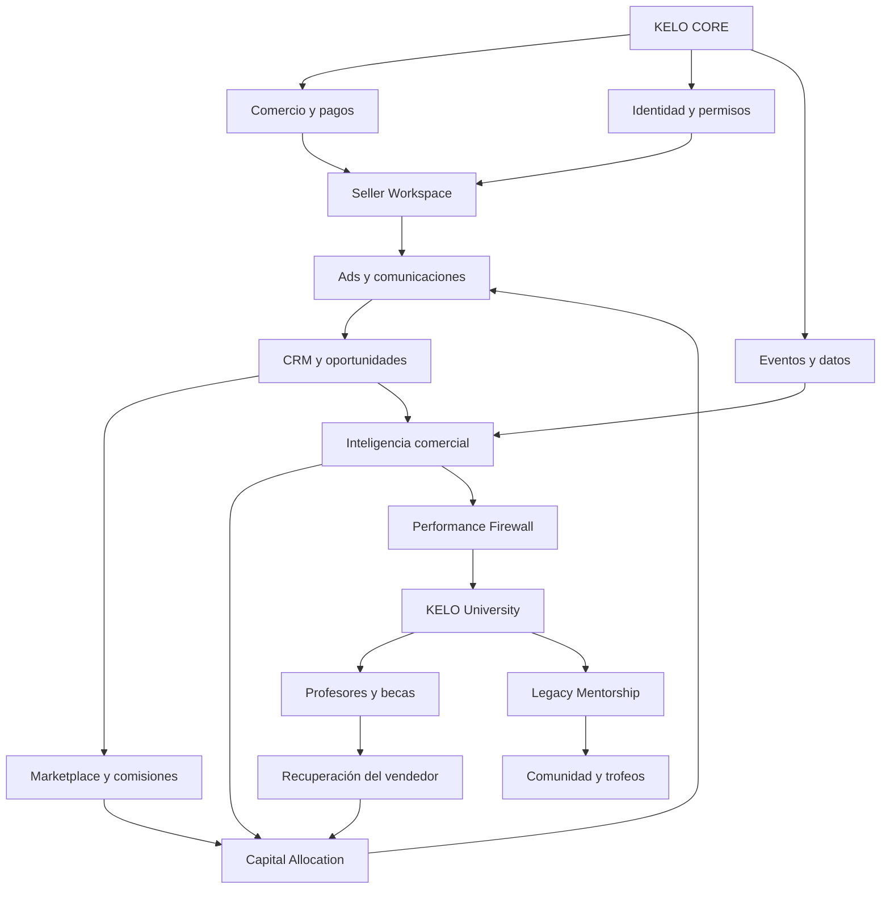

# KELO BUSINESS OS — Documento maestro V6.0
**Fecha:** 26 de noviembre de 2026  
**Estado:** especificación conceptual consolidada; no certifica implementación ni rentabilidad.  
**Propósito:** fuente de verdad del proyecto para dirección, desarrollo y futuras sesiones de IA.

## 0. Especificación funcional — cómo se usa KELO BUSINESS OS
Esta sección es el mapa de lectura para una persona nueva y la especificación de pantallas y flujos. Los capítulos 1–82 conservan reglas detalladas, hipótesis y decisiones; consultar precedencia del capítulo 75. Todo lo descrito es producto objetivo, no software ya operativo. Los nombres de botones son propuestas de interfaz; traducir al inglés comercial. Las integraciones no disponibles deben mostrar estado pendiente y alternativa, nunca simular éxito.

### 0.1. Qué estamos construyendo
Una plataforma comercial que combina tienda online, oficina de vendedor, administrador de publicidad, comunicaciones, mercado de oportunidades, formación, comunidad y administración empresarial. Kelo Diamonds es la primera marca y el fundador el primer vendedor. Un comprador puede comprar solo o recibir asistencia; un vendedor puede captar sus clientes, atender los de la empresa, colaborar, recuperar ventas y cobrar comisiones por ventas reales. La empresa controla catálogo, pagos, inventario, entrega, márgenes y reglas. Una identidad con roles permite cambiar de espacio sin crear cuentas duplicadas. No es una red de inversión ni un negocio de reclutamiento remunerado.

### 0.2. Navegación y pantallas
Menú vendedor: Inicio, Workspace, Conexiones, Anuncios, Bandeja, CRM, Llamadas, Propuestas, Marketplace, Exchange, Recovery, Reservas, Mi tienda, Grupos, Comunidad, Academia, Misiones, Trofeos, Perfil, Ingresos, Calendario y Ajustes. Búsqueda global y notificaciones con permisos. Menú CEO añade Finanzas, Catálogo, Inventario, Pedidos, Entregas, Proveedores, Vendedores, Comisiones, Club, Growth, Autopilot, Integraciones, Seguridad y Auditoría. Comprador: tienda pública, producto, carrito, checkout, consulta privada, sala de propuesta y cuenta Club. Afiliado: mini tienda, enlaces, materiales, métricas e ingresos; módulos adicionales según certificación. Proveedor externo autorizado: ofertas, disponibilidad, pedidos/contratos, evidencias y liquidaciones propias. Menú móvil compacto y paneles adaptables. No exponer módulos sin permiso.

### 0.3. Funciones, pantallas y comportamiento
Cada fila describe pantalla, controles, efecto y comprobación mínima. Reutilizar entidades y reglas de capítulos referenciados. En todas las acciones: validar permisos y datos en servidor, mostrar carga/error/confirmación, persistir cambios, auditar acciones sensibles y probar recarga, concurrencia y acceso indebido.

| Módulo / pantalla | Funciones y controles | Resultado y aceptación |
|---|---|---|
| Registro e identidad (3,21) | Crear cuenta, verificar email, recuperar contraseña, iniciar sesión, cambiar rol autorizado, MFA admin | Perfil único, permisos efectivos, sesión revocable; usuario no accede a cuentas ajenas. |
| Inicio vendedor (45–46) | Ver tareas, conversaciones pendientes, ventas, comisión, costo publicitario, agenda; abrir tarea | Navega al caso real, cifras conciliadas y fecha visible; sin datos muestra vacío. |
| Workspace (46) | Añadir panel, arrastrar, redimensionar, minimizar, cerrar, guardar preset Sales/Ads/Calls/Recovery/Team/CEO | Conserva distribución y borradores; chat y campaña pueden coexistir; móvil usa pestañas. |
| Connect (5,46) | Conectar Facebook/Instagram/Messenger/WhatsApp Business/Meta Ads/Stripe, seleccionar activos, comprobar, desconectar | OAuth o incorporación oficial, QR solo si admitido; mostrar permisos y estado real; revocar detiene acceso. |
| Ads Express (5,46) | Elegir producto, destino, creativo, audiencia, presupuesto, duración; vista previa, guardar borrador, autorizar publicación | Crea campaña/conjunto/anuncio en cuenta autorizada; sin aprobación no gasta. |
| Ads Pro (5) | Editar, duplicar, pausar, reactivar, cambiar presupuesto, filtrar por fecha y campaña | Sincroniza estado real, confirma gasto, registra errores y límites; no modifica cuenta ajena. |
| Profit Radar (5,17) | Ver gasto, chats, costo/chat, ventas atribuidas, CAC, margen, comparar campañas | Une eventos permitidos con pedidos; desconocido se marca como tal; descuenta gasto una vez. |
| Creative Vault / Social Manager (5) | Subir/seleccionar material aprobado, preparar publicación, programar, responder comentarios compatibles | Guarda versiones, permisos y estado de publicación; no usa contenido no autorizado. |
| Bandeja unificada (7,46) | Filtrar WhatsApp/Instagram/Messenger, abrir chat, responder, adjuntar catálogo, marcar pendiente, asignar, buscar | Envía por API oficial dentro de reglas del canal, muestra entrega/error; conserva historial y opt-out. |
| Copiloto y recepcionista IA (7) | Activar/desactivar, sugerir respuesta, aceptar/editar, solicitar humano, resumir | Usa precio/stock/FAQ verificados; handoff detiene auto respuestas, presupuesto y fallback manual. |
| CRM (8) | Crear cliente/lead/oportunidad, registrar origen, producto, objeción, notas, estado, tarea y cita | Historial único con permisos, no fusiona por nombre, transición auditada, exclusión bloquea contacto. |
| Catálogo vendedor (4,18) | Buscar SKU, variantes, stock, precio, comisión, fotos y certificados; compartir producto | Datos de servidor, sin prometer stock inexistente; activos autorizados. |
| Enlace de pago (4,13) | Elegir SKU/cantidad, descuento permitido, cliente, entrega; generar enlace | Pedido y atribución vinculados; Stripe confirma mediante webhook, no por captura de pantalla. |
| Direct Call (47–48) | Generar enlace kelodiamonds.com/call/..., copiar/enviar, aceptar invitado, silenciar, finalizar | Cliente entra sin instalar, permisos explícitos, enlace privado expirable, audio WebRTC y fallback. |
| Smart Calling (29,47) | Elegir canal elegible, iniciar/recibir, transferir, registrar resultado, programar callback | WhatsApp cuando autorizado/compatible, WebRTC por invitación, VoIP legal como fallback; no eludir restricciones. |
| Live Shopping (48) | Mostrar producto, comparar, compartir foto/video, cámara opcional, abrir propuesta y checkout | Cliente controla su pantalla; selección sincronizada, precio real y compra vinculada al asesor. |
| Call Intelligence (29) | Solicitar consentimiento, grabar/transcribir si autorizado, ver resumen y sugerencias, corregir resultado | Sin consentimiento no procesa audio para análisis; acceso limitado y costos medidos. |
| Outbound / prospectos (28) | Importar fuente autorizada, filtrar empresa/sector, aceptar prospecto, registrar llamada/cita/resultado | Deduplicación, elegibilidad de contacto, titular único; no campañas masivas no solicitadas. |
| Propuestas (30) | Seleccionar producto, necesidades, argumentos y activos; generar borrador, editar, aprobar, compartir | Página privada premium versionada con precio/condiciones verificadas; no publicar borrador sin aprobación. |
| Video Factory (30) | Elegir Express/Personalizado/Cinemático, previsualizar, aprobar | Plantillas y activos compartidos primero; trabajos asíncronos, presupuesto, fallback si falla. |
| Digital Sales Room (30) | Cliente abre propuesta, consulta documentos, chat, agenda, firma si disponible, reserva o paga | Acceso privado, versión aceptada inmutable, seguimiento permitido, sin PII en URL. |
| Dual Close (31) | Mostrar pago completo y reserva, elegir importe autorizado, aceptar condiciones, pagar saldo | Reserva acreditada al precio; no contar como venta final; vencimiento y devolución claros. |
| Completion (31) | Ver reservas pendientes, saldo, fecha, contactar autorizado, delegar, cerrar | Una oportunidad y atribución conservadas; comisión no duplicada; no presionar ni ocultar términos. |
| Marketplace / Closers (9) | Filtrar producto, comisión, dificultad, antigüedad; aceptar, liberar, transferir | Tarjeta anónima antes de claim; aceptación atómica, plazo respuesta y capacidad; solo responsable autorizado accede. |
| Exchange (10,38) | Publicar oportunidad propia, elegir comisión cedida/retenida, contraofertar, aceptar, activar reglas | Acuerdo congelado; no venta de datos, reparto dentro de presupuesto; pago solo por venta/servicio válido. |
| Recovery (11) | Ver perdidas elegibles, motivo, historial, comisión, aceptar, generar estrategia, cerrar o archivar | Excluye opt-out, distingue causas, no premia pérdida intencional; mide incremento real. |
| Commercial DNA (12,34) | Ver radar de habilidades, evidencia, muestras, recomendaciones, solicitar revisión | Conductas observables, no diagnóstico; datos escasos muestran incertidumbre; asignación por elegibilidad y capacidad. |
| Academy / Sales Gym (15) | Elegir curso, estudiar, practicar cliente simulado, examen, feedback, certificación | Guarda progreso y rúbrica; certificación interna habilita oportunidades aprobadas, no licencia pública. |
| Mi tienda / afiliados (6) | Elegir productos autorizados, personalizar perfil, copiar enlace/QR/código, consultar ventas | Una plantilla dinámica, stock compartido, atribución servidor; sin cuotas ni compras obligatorias. |
| Misiones (14) | Ver requisitos, remuneración, plazo, aceptar, entregar evidencia, reclamar revisión | Pago por servicio o venta real validada; presupuesto y contrato previo, no reclutamiento. |
| Ingresos (13–14) | Ver pendiente/devengado/disponible/pagado/revertido, gastos propios, exportar, solicitar liquidación si habilitada | Ledger único en centavos, conciliación, plazos legales; no saldo bancario ni ingresos garantizados. |
| Grupos (38) | Crear, invitar, aceptar, agregar trato, repartir igual/custom, aprobar, asignar tareas, salir | Acuerdo por trato congelado, suma exacta, titular único; salida no borra derechos previos. |
| Comunidad (40) | Chat global/canales, buscar equipo, pedir ayuda, mentoría, publicar logro, reaccionar, bloquear/reportar | Moderación, privacidad, opt-in, canales segmentados; no datos de clientes ni spam. |
| Legacy / perfil (41) | Ver ventas y cierre con denominador, inventario de trofeos, elegir hasta nueve, publicar, seguir, invitar | Certificado no transferible tras venta válida, rareza por comisión individual, reversión auditada, privacidad. |
| Calendario / tareas (20) | Crear cita, entrega, seguimiento, recordatorio; completar/reprogramar | Respeta zona horaria, permisos y exclusión; alerta no duplica tarea. |
| CEO Finanzas (17,42) | Filtrar ciclo 20→20, ver ingresos/caja/COGS/margen/gastos/beneficio, simular metas, exportar | Conciliación y fórmula maestra; no confundir caja, GMV y beneficio. |
| CEO Vendedores (3,12,35) | Aprobar roles, revisar activación, formación, carga, rendimiento, disputas, suspender con revisión | Permisos y motivos auditados; no decisiones graves solo por IA. |
| CEO Comisiones (13) | Crear regla versionada, simular margen, aprobar, conciliar, liquidar, ajustar devolución | No cambios retroactivos arbitrarios, no doble pago, suma dentro del presupuesto. |
| CEO Catálogo/Inventario (18) | Crear/editar SKU, costo, precio, stock, compra proveedor, reservar, ajustar con motivo | Movimientos auditados, stock disponible=físico−reservado, concurrencia segura. |
| CEO Pedidos/Entregas (4,18) | Confirmar pago, preparar, asignar, programar, entregar, devolver, reembolsar | Estados pago/entrega separados, evidencia y costo; webhook firmado y conciliación. |
| Proveedores / High Ticket (28) | Alta y contrato, crear oferta, comisión, territorio, requisitos, validar venta/entrega, liquidar | Solo ofertas verificadas y legales, permisos por proveedor, no promesas de comisión no financiada. |
| Soporte (18) | Crear ticket, asignar, responder, resolver, reabrir, tramitar garantía | Historial y SLA, datos privados, reembolso por flujo autorizado. |
| Growth (19) | Editar landing, preview, publicar, artículos, SEO, experimentos, promociones, waitlist | Versiones y rollback, preservar URLs, medir contribución, no indexación garantizada ni reseñas falsas. |
| Autopilot (20) | Elegir evento, condición, acción, simular, activar, pausar, ver ejecuciones | Idempotencia, permisos, topes, no bucles, no gasto/contacto sin autorización. |
| Resource Governor / Health (35,42–43) | Ver costos, cuotas, latencia, colas, conectores, alertas, autorizar presupuesto | Límites efectivos, degradación segura, pagos no bloqueados por cuota IA, pruebas de carga. |
| Tienda pública (4) | Explorar, buscar, elegir variante, añadir carrito, hablar con asesor, checkout invitado | Estética premium existente, stock/precio real, compra segura, no registro obligatorio. |
| Club comprador (16) | Ver pedidos, tracking, garantías, colección, wishlist, créditos, nivel, soporte y referidos | Beneficios configurables, ledger promocional, consentimiento y reversión; no crédito convertible en efectivo. |

### 0.4. Historias completas de uso
**Jornada del fundador:** inicia sesión → conecta activos Meta autorizados → abre Ads y Bandeja lado a lado → crea anuncio en borrador y autoriza presupuesto → entra conversación real → CRM registra origen si disponible → responde con catálogo → envía enlace Direct Call oficial → cliente acepta → muestra producto → genera propuesta → cliente paga o reserva → Stripe confirma → inventario y entrega se actualizan → ledger calcula comisión → panel muestra contribución y costo/chat → al completarse venta se emite trofeo elegible. Si no compra, registra motivo y seguimiento permitido; Recovery solo si elegible.
**Vendedor sin presupuesto:** se registra, verifica y forma → acepta oportunidad corporativa anónima → atiende dentro del plazo → genera enlace de pago → venta completada → comisión según acuerdo → liquidación. Si no puede atender, libera sin duplicar titularidad.
**Captador con publicidad propia:** conecta su cuenta, autoriza campaña, recibe lead privado → si saturado publica Exchange con $40 totales, $35 closer y $5 captador → otro acepta → venta validada → ledger reparte $35/$5; si no vende no se devenga comisión de venta. 
**Equipo:** crea grupo, invita, adjunta trato, acuerda $1,000 entre tres ($333.34/$333.33/$333.33), todos aceptan → colaboran con permisos → cierre → reparto y trofeos individuales; devolución genera ajuste.
**Comprador autónomo:** entra tienda o mini tienda → elige producto → checkout invitado → pago → entrega → opcionalmente crea cuenta verificada para Club. Si solicita asesor, entra cola y vendedor acepta; si nadie disponible, chat asincrónico.
**High ticket:** proveedor autorizado publica oferta → prospector cualifica empresa elegible → setter agenda → closer atiende llamada → propuesta personalizada y reserva → saldo/contrato/entrega según condiciones → proveedor verifica y paga → liquidación de participantes. No asumir que una reserva equivale a ingreso final.

### 0.5. Qué debe ocurrir cuando algo falla
Pago rechazado: mantener pedido pendiente y permitir reintento seguro. Webhook repetido: no duplicar venta/comisión. Stock agotado: impedir cobro incompatible y ofrecer alternativa. Meta desconectado: conservar historial autorizado y mostrar reconexión, no fingir envío. Cliente rechaza micrófono: chat. IA falla: vendedor sigue manualmente. Vendedor abandona oportunidad: liberar conforme a reglas y conservar origen. Cliente pide no contacto: bloqueo global inmediato. Devolución: ajustar ledger, stock, beneficio y trofeo. Permiso insuficiente: denegar en servidor. Presupuesto agotado: detener acciones costosas no esenciales y avisar. Ningún error debe borrar registros financieros.

### 0.6. Orden y definición de terminado
Primero auditar código existente y preservar tienda. Fundamentos transaccionales, Seller Zero Workspace y conectores; luego Direct Call/Live Shopping, propuestas y doble cierre; después red, Exchange/Recovery, comunidad, Legacy y optimización predictiva según datos. Una misión integrada con dependencias y flags; no exigir aprobaciones por cada módulo, sí ante gasto, riesgo irreversible o credenciales. Cada pantalla debe tener ruta, estados vacío/carga/error/éxito, acciones reales, permisos, persistencia, móvil, pruebas y documentación. No confundir prototipo con integración funcional. Meta, WhatsApp, telefonía, Stripe y proveedores requieren validación real. Escala objetivo 500k vendedores/1M compradores, no capacidad probada. Fórmula de beneficio y presupuestos en 42–43.

### 0.7. Índice funcional vigente y precedencia
La visión vigente comprende capítulos 0–82. Los capítulos posteriores amplían los anteriores; ante conflicto aplicar las decisiones explícitas de consolidación del capítulo 75, sin borrar antecedentes. KELO es una plataforma Learn–Earn–Grow: universidad abierta, empresa comercial móvil y red flexible de oportunidades, inspirada en DoorDash para ventas. No exige dedicación exclusiva ni compra de formación. Kelo Diamonds es primera operación y Seller Zero el fundador.
| Dominio | Capítulos de referencia |
|---|---|
| Comercio, club, operaciones y growth | 4,16,18,19 |
| Workspace, Meta, comunicaciones, llamadas, propuestas | 5,7,28–32,45–51 |
| CRM, marketplaces, atribución, compensación y grupos | 6,8–14,34–35,38,76 |
| Calidad, inteligencia, capital y recuperación de talento | 50,52–55,77 |
| Academia pública, práctica, docentes, becas y mentoría | 15,56–58,69–74,78–79 |
| Comunidad, reputación y legado | 40–41,58,79 |
| Finanzas, arquitectura, costos, competencia y entrega | 17,20–26,42–43,61–68,80–82 |
Navegación actualizada: público: Tienda, Academia, Biblioteca, Cursos, Verificar certificado; alumno: Aprender, Practicar, Repasar, Simular, Certificados, Perfil; vendedor: añadir Daily Board, Disponibilidad, Mi rendimiento, Plan de mejora, Second Chance, Becas, Mentoría; instructor: Course Studio, Live Campus, Alumnos, Resultados, Liquidaciones; CEO: añadir Ghost, Firewall, Capital, Becas, Moderación, Costos, Salud de integraciones y Competencia. Roles acumulables autorizados, no cuentas separadas. En móvil, navegación contextual por tareas y búsqueda; no mostrar decenas de pestañas simultáneas.

## 1. Visión y modelo empresarial
Kelo Diamonds comercializa joyería propia y centraliza catálogo, inventario, cobros, garantías y logística. Una red de participantes capta, asesora, vende, delega y recupera clientes. La ventaja buscada es maximizar la contribución económica por cliente adquirido, no solo reducir el costo por conversación. Objetivo empresarial de referencia: $30,000 mensuales de beneficio operativo, sujeto a validación. El sistema podrá reutilizarse para otras marcas con aislamiento estricto de datos y finanzas. No es un programa de inversión ni una promesa de ingresos.
 
## 2. Principios y arquitectura
Una aplicación modular, una base de datos transaccional, un sistema de identidad y permisos, un motor de eventos, un ledger de comisiones, un motor de marketplaces, una plantilla dinámica de tiendas, conectores Meta/WhatsApp/Stripe y una pasarela IA. Reutilizar código existente; no crear quince aplicaciones ni microservicios innecesarios. Priorizar seguridad, integridad financiera, conversión, margen y costos. Preservar landing, estética premium negro/plata, catálogo, URLs indexadas, contenido y configuraciones existentes. Mobile-first, accesible, inglés comercial con traducciones centralizadas. La arquitectura concreta dependerá de la auditoría del código.

## 3. Roles y paneles
Administrador/CEO: control global, finanzas, campañas, inventario, reglas y auditoría. Roles delegados: finanzas, ventas, inventario, logística, contenido y soporte. Acquirer: capta clientes propios. Closer: selecciona y cierra oportunidades. Recovery Specialist: recupera operaciones elegibles. Affiliate: promociona mini tienda. Elite Partner: opera tienda y presta apoyo comercial verificable. Customer: compra y disfruta beneficios. Una persona puede combinar roles autorizados. Permisos server-side por entidad y acción; MFA para administración. Registro, verificación, recuperación de contraseña, consentimiento y suspensión con historial.

## 4. Comercio y checkout
Landing con video optimizado, precio y CTA visibles, prueba verificable, garantías y FAQ. Checkout invitado como opción principal, Stripe Checkout alojado, tarjetas y wallets compatibles; WhatsApp asistido secundario. Precios, descuentos, impuestos, envío y stock calculados en servidor. COD solo zonas y condiciones aprobadas; depósito parcial no equivale a pago total. Upsell opcional, bundles y productos complementarios. Enlace manual de pago desde CRM: cliente, SKU, cantidad, descuento autorizado, pedido y vendedor vinculados. Webhook firmado e idempotente confirma importe, moneda y pedido. Estados separados de pago y entrega; reembolsos, disputas y conciliación. Nunca almacenar datos de tarjeta ni vender falsificaciones. Vincular pedidos de invitado a cuenta solo tras verificación.

## 5. Ads Engine y Meta Connect
Tres canales: Corporate Ads (Kelo paga), Seller Ads (vendedor paga y conserva atribución), Affiliate Ads (mini tienda). OAuth oficial, seleccionar activos autorizados: página Facebook, Instagram, cuenta publicitaria, dataset/píxel. Marketing API para campañas, conjuntos, anuncios, creativos, presupuestos, pausa y estadísticas; permisos y revisión de Meta pendientes. Social Manager para publicaciones, calendario, comentarios y métricas cuando permisos lo permitan. Ads Express: elegir producto, destino (tienda/chat/IA+humano), creativo aprobado, audiencia/ubicación permitida, presupuesto, duración, revisar y autorizar publicación. Ads Pro para usuarios avanzados. Meta cobra difusión; API no tiene tarifa por llamada conocida, pero hay límites y costos de infraestructura. Vendedor paga directamente a Meta; no custodiar fondos publicitarios. Guardar tokens cifrados, revocación y aislamiento por cuenta. Campañas en borrador por defecto; no gastar sin autorización. Presupuesto total y límites explícitos, alertas, parada de emergencia, reconciliación de gasto real. Creative Vault con imágenes, videos, textos y rendimiento agregado por producto/mercado; no compartir datos privados. Smart Campaign recomienda cambios por CAC, margen, stock, capacidad y muestra suficiente. No prometer ROAS. Conversion Bridge envía eventos permitidos y deduplicados a Meta, sin chats ni perfiles psicológicos. Simulador: gasto / costo por conversación × tasa de cierre × comisión menos gasto. Publicidad orgánica y pagada deben identificar relación comercial cuando corresponda.

## 6. Mini tiendas, afiliados y atribución
Todos los afiliados aprobados reciben una mini tienda dinámica, p. ej. /shop/seller001, no una copia de la aplicación. Inicialmente 3 productos; niveles superiores desbloquean selección y catálogo aprobado. Links por producto, QR, códigos, materiales y métricas. Compra directa desde tienda: ID validado en servidor, persistido en carrito, pedido y sesión Stripe; no requiere cookie. Para regreso posterior: cookie first-party con consentimiento y duración configurable (propuesta 90 días), cuenta verificada o código; no fingerprinting. First-click protegido como hipótesis inicial, conflictos con código/otro vendedor mediante reglas explícitas y revisión. No garantizar atribución anónima entre dispositivos. Smart Links conservan referencia y muestran alternativas si no hay stock. Guardar captador, propietario de tienda, closer, recuperador, campaña y versión de regla. Evitar cookie stuffing, autorreferencias, clics falsos, duplicados y manipulación. Red de partners inicialmente de un nivel directo, sin remuneración por reclutamiento; cualquier pago de apoyo debe corresponder a servicio real verificable y pasar revisión legal. No exigir compras, cuotas de ingreso ni reclutar para ascender.

## 7. KELO Chat y agentes IA
WhatsApp Business Cloud API oficial: webhook entrante, cola, conversación central, envío autorizado por Graph API, historial, plantillas y ventana de atención aplicable. No automatizar WhatsApp Web ni eludir políticas. Cliente conversa con número comercial; vendedor trabaja desde panel, sin compartir credenciales. Recepcionista responde preguntas; Qualifier identifica intención y objeciones; Copilot sugiere respuestas; Analyst extrae eventos y motivos; Coach recomienda formación; Auditor revisa calidad; Recovery AI prepara briefing. Usar catálogo/FAQ/stock/precios reales, nunca inventar garantías, descuentos o pagos. Handoff exclusivo IA-humano, detener respuestas automáticas durante control humano. Escalamiento a persona cuando se solicita. Resumen de contexto, modelos económicos, análisis por lotes, límites diarios y por conversación, fallback manual. No usar conversaciones para entrenar modelos generales sin base y permisos apropiados. Verificar términos de Meta, consentimiento y costos por mensajes/IA antes de activar.

## 8. CRM y cualificación
Cliente, lead y oportunidad son entidades distintas. Historial, origen, producto, presupuesto expresado, objeciones, agente, siguiente acción, consentimiento, pedidos, LTV y recompensas. Score inicial configurable basado en señales observables: precio +10, producto +15, presupuesto +15, pago +20, entrega +20, solicita humano +30, confirma compra +40; no interesado reduce score y opt-out bloquea contacto. No confundir score con probabilidad calibrada. Estados: New, Qualified, Available, Claimed, Negotiating, Payment Pending, Sold, Unclaimed, Lost, Under Analysis, Recovery Eligible, Recovery Available, Recovery Claimed, Recovered, Dormant, Do Not Contact, Archived. Registrar razones y transiciones. Segmentos: pendientes, carritos elegibles, interesados, recurrentes, inactivos, VIP. Seguimiento consentido, no contacto indiscriminado.

## 9. Closers Network
Marketplace inspirado en viajes reservados: tarjetas anónimas antes de aceptar, producto, comisión, antigüedad, dificultad, compatibilidad y condiciones. El vendedor elige; no se envía todo a una persona. Claim atómico, una sola titularidad activa, límite de casos simultáneos, plazo configurable de primera respuesta (ejemplo 5 min), liberar si no atiende, proteger conversación activa y permitir transferencia autorizada. Prioridad por certificación, calidad y rendimiento, con cupos de exploración para nuevos vendedores. Niveles Trainee, Silver, Gold, Platinum, Diamond, Elite; afiliado básico separado. Leads de publicidad propia son privados y no se publican sin autorización. Enlace Stripe asociado a oportunidad, pedido y responsable. Comisión pendiente al pago, validación conforme a entrega/devoluciones y reglas legales. Estadísticas: aceptadas, cerradas, perdidas, abandonadas, respuesta, tiempo de cierre, enlaces, conversión, ticket, margen, descuentos, upsell, devoluciones, satisfacción y comisión. Separar fallos del vendedor de stock, logística, IA o mala cualificación.

## 10. Opportunity Exchange
Mercado secundario para oportunidades propias que el captador no quiere o no puede atender. Ejemplo: comisión total $40; ofrece $35 al closer y conserva $5 si se completa la venta. También $20/$20. No vender datos personales ni cobrar por aceptar; transferir responsabilidad comercial y participación contingente. Oferta fija, sugerida, escalado autorizado o contraoferta. Auto Exchange por saturación, falta de tiempo o mejor compatibilidad, con mínimo retenido y máximo cedido. Mostrar razón, antigüedad, comisión y reputación del captador; ocultar identidad del comprador hasta claim autorizado. Acuerdo digital congelado al aceptar: origen, responsable, importes, versión, plazo, condiciones, cancelación y disputa. Claim transaccional, deduplicación, historial, no reventa infinita, inicialmente dos beneficiarios del intercambio. Proteger atribución original incluso al recuperar, financiar incrementos con presupuesto aprobado. 100 descartadas × 30% de cierre × $5 = $150, no $500 salvo que todas cierren. Reputación ajustada por dificultad y calidad de información.

## 11. Recovery Engine
Dos colas distintas: oportunidades no tomadas/caducadas y operaciones atendidas pero perdidas. Ambas pasan por análisis y elegibilidad, no se eliminan automáticamente. Clasificar precio, confianza, duda técnica, tiempo, pago, stock, mala atención, sin respuesta, error de IA o logística. Distinguir no ahora de no contactar. Recovery Marketplace para especialistas certificados con comisión superior cuando margen lo permita. Ejemplo base $40; R1 $45 no tomada, R2 $50 sin respuesta, R3 $55 objeción, R4 $65 perdida, R5 $80 compleja; hipótesis, no tarifas activas. Briefing con historial, motivo sustentado, recursos, estrategia y alternativas. Especialidades negociación, confianza, reactivación, técnica, premium y reparación de experiencia. Call Center: click-to-call, resultado, historial, callback, guion, enlace Stripe, análisis de llamada solo con permisos. Telefonía (p. ej. Twilio) tiene costo; verificar DNC, TCPA, horarios, consentimiento y grabación por jurisdicción. Límites globales de contacto, exclusión inmediata, archivo y retención limitada. Bloquear incentivos a perder intencionalmente ventas para recuperarlas por más dinero; no permitir incremento propio sin revisión. Recovery Attribution: enlace/código específico, evidencia de contacto, ventana y grupo de control; medir ventas incrementales, no atribuir automáticamente toda compra posterior. Recovery Lab compara argumentos, alternativas, descuentos y grupo sin contacto entre elegibles; maximizar beneficio incremental.

## 12. Seller DNA, Match y Event Engine
Perfil dinámico de conductas comerciales observables: Closer (directo), Hunter (seguimiento respetuoso), Advisor (técnico), Connector (relacional), Strategist (negociación/margen). No diagnosticar personalidad ni inferir atributos sensibles. Eventos: lead_viewed, accepted, first_response, objection_resolved, follow_up, product_explained, discount_requested, upsell, payment_link_sent, payment_confirmed, released, opted_out, refunded, feedback. Seller Score propuesto: contribución/lead 30%, cierre ajustado 25%, calidad 15%, cumplimiento 15%, velocidad 10%, satisfacción 5%. Ajustar por mezcla de casos y muestra; incertidumbre explícita. Match recomienda vendedor según necesidad y resultados, no obliga. Valor esperado = probabilidad calibrada × (margen antes de comisión − comisión) − costos adicionales. Iniciar con reglas y luego modelos estadísticos si hay datos suficientes. No vigilancia de pantalla/cámara/teclado. Informar criterios, revisión humana, reclamación y no decisiones laborales graves exclusivamente automatizadas.

## 13. Compensation Engine 2.0
Un ledger auditable para todas las fuentes: captación, cierre, afiliación, recuperación, apoyo verificable, misiones, contenido y bonos. Regla versionada por SKU/canal/rol/cliente nuevo o recurrente; importes en centavos; congelar acuerdo al aceptar; no cambios retroactivos arbitrarios. Comisión base, multiplicador por dificultad, límites por margen y presupuesto. Propuestas para pruebas: cierre 15–25%, adquisición propia 25–35%, afiliado orgánico 15–25%, recurrente atribuido 5–15%, recuperación 20–35%, bonos 2–10%; no acumular automáticamente. Base porcentual explícita: venta neta elegible excluyendo impuestos, envío y devoluciones según contrato. Escalones marginales de productividad ilustrativos: primeros $500 20%, siguiente tramo hasta $1,500 25%, hasta $5,000 30%, hasta $10,000 32%, exceso 35%. Aplicar solo si margen lo permite; no retroactividad ni saltos de costo. Estados pending, validation, approved, available, paid, reversed; reglas de salario y plazos legales prevalecen. Reembolsos parciales y disputas generan ajustes auditables; no duplicar webhooks ni pagos. Liquidación manual inicial, calendario semanal/quincenal configurable, conciliación y documentación fiscal. No tratar saldo interno como depósito bancario. Ejemplo $189 − $30 producto − $8 logística − $5.78 Stripe estimado − $5 captador − $35 closer = $105.22 contribución antes de otros costos. Si participan varios roles, suma dentro del límite; incremento de recuperación autorizado aparte. Margin Guard considera descuentos, recompensas, CAC, IA, telefonía, devoluciones y contribución mínima. Mostrar ingresos brutos, gastos propios y resultado, no promesas.

## 14. Commercial Missions y Earnings Engine
Misiones con contrato y presupuesto: lanzamiento, ventas verificadas, recuperación, contenido, formación o apoyo comercial real. Mostrar requisitos, remuneración fija/variable, plazo, entregables, aprobación y disputa antes de aceptar. Product Sponsorship: muestras a participantes productivos con disclosure, sin compras obligatorias. Descuento personal sin comisión. Acquisition Premium para cliente nuevo verificable; bonos por contribución rentable y calidad. Panel de ingresos por canal, pendientes/disponibles/pagados, publicidad propia, costos, calendario y exportación. Advertising Fund: reinversión voluntaria de comisiones y posible aporte promocional aprobado de Kelo (ej. $100 + $20), nunca retención obligatoria ni gasto automático sin autorización. Certificaciones internas, no licencias gubernamentales: Seller, Jewelry Expert, Premium Closer, Recovery, Media Buyer, Mentor, Elite Partner.

## 15. Academy y formación
Sales, Ads, Recovery, Product, Negotiation, Partner Academy y Sales Gym. Lecciones breves, examen, simulación de cliente, evaluación práctica, feedback de errores reales, objetivos y medición antes/después. Acceso progresivo a oportunidades por competencia y calidad, no por reclutamiento. Formación sobre materiales, publicidad honesta, privacidad y contacto. Mentores remunerados por servicio verificable.

## 16. Private Club y fidelización
Cuenta cliente con compras, tracking, garantías, certificados auténticos, colección digital, wishlist, preferencias, soporte y beneficios. Niveles propuestos Silver 2%, Gold $250/3%, Platinum $750/4%, Diamond $1500/5%, Black $3000/6%; validar economía antes de activar. Wallet promocional no transferible ni convertible a efectivo, ledger único, pendientes/uso/reversión, términos claros. Referido cliente $5 descuento y $10 crédito al referidor como hipótesis, tras venta válida y plazo aplicable; sin autorreferencias. Discover, drops reales, votaciones de producto, waitlist, guías y Style Lab basado en reglas. Misiones voluntarias y XP simbólico, no ruletas pagadas, urgencia falsa ni penalización por ausencia. Consentimiento para notificaciones. No recompensar exclusivamente reseñas positivas.

## 17. Finance y CEO Command Center
Dashboard móvil: hoy/mes, ingresos, cobros, COGS, margen bruto, contribución, beneficio operativo, caja, cuentas pendientes, gastos, comisiones, CAC, ROAS, conversión, devoluciones, AOV, LTV, inventario y entregas. Ciclo configurable 20→20 y zona NY. Separar efectivo de ingresos y beneficio de facturación. Datos faltantes N/A. Simuladores de precio, volumen, CAC máximo, break-even, presupuesto y flujo 30/90/365 días. Objetivos diarios/semanales/mensuales, ritmo requerido y escenarios explícitos. CEO Inbox prioriza acciones: stock, seguimientos, campañas, recuperación y soporte. Lead Yield Engine mide contribución por cohorte desde adquisición hasta cierre/archivo, deduplicando etapas y descontando costos completos. Ejemplo hipotético $1,000 / 80 ventas = CAC publicitario $12.50; /255 = $3.92, no CAC completo. Medir incremento real mediante grupos de control y costos por etapa. Exportación CSV, costos históricos y conciliación; no sustituye contabilidad fiscal.

## 18. Operations
Inventario por SKU/variante: físico, reservado, disponible, costo, precio, proveedor, movimientos y umbral. Reserva atómica, expiración, pagos tardíos y concurrencia. Proveedores: MOQ, lead time, defectos, compras y calidad. Logística separada de pago: Pending, Confirmed, Preparing, Ready, Scheduled, Out for Delivery, Delivered, Cancelled, Returned. Asignación, horario, zona, dirección protegida, evidencia, intentos, millas, tiempo, combustible, peajes, costo por entrega y margen/hora. Garantías, devoluciones y soporte con tickets, responsables, estados e historial. No publicar datos personales en tracking; enlaces no adivinables.

## 19. Growth Engine
Landing Builder reutiliza componentes, borrador/preview/publicación explícita/versiones. SEO: sitemap, robots, canonical, metadatos, schema producto/organización/breadcrumb, redirecciones, Search Console, noindex privado; preservar URLs, no prometer indexación. Content Engine: artículos, guías, fundador, investigación y testimonios verificados, sin spam ni reseñas falsas. Market Lab: validación de demanda con waitlists honestas; Pricing Lab y Creative Lab con pruebas A/B, asignación estable y tamaño suficiente. Growth events: visitas, video 25/50/75/100, producto, carrito, checkout, WhatsApp click (no equivale a conversación), lead confirmado, link, compra, devolución, entrega, referido, repetición, wishlist, registro, waitlist. UTMs, dedupe, consentimiento, GA4/Meta si configurados. RFM, cohortes, recomendaciones por reglas, recuperación de carritos y clientes inactivos elegibles. Promos fijas/porcentaje/bundle/segunda unidad/envío/VIP/referidos, límites y simulador de margen. Cooperative Intelligence comparte resultados agregados comparables, no datos privados.

## 20. Autopilot y herramientas internas
Motor trigger-condition-action con idempotencia, reintentos limitados, prevención de bucles, log y permisos. Eventos: lead cualificado, no aceptado, perdido, pago, entrega, refund, stock, referral, ascenso, promoción, seguimiento, soporte, objetivo. Acciones: publicar elegible, crear tarea, alertar, actualizar estado autorizado, comisión/recompensa, sugerir cambios. Telegram Bot API para avisos configurables y resumen opcional, enlaces protegidos sin datos sensibles; fallo no revierte pedido. Calendario central de entregas, campañas, drops, publicaciones, tareas y seguimientos. Búsqueda global con permisos. Configuración central, feature flags, auditoría y backups. PWA móvil y push voluntario si viable. Sin polling constante ni servicios pagados innecesarios.

## 21. FTC, privacidad y cumplimiento
No pagar por reclutar, exigir inventario ni compras personales para ascender. Verificar ventas minoristas reales y servicios auténticos; tener producto real no basta para validar un esquema de compensación. Disclosure visible de afiliación, anuncios honestos, no ingresos garantizados, informes típicos incluyendo participantes sin ingresos y gastos. Revisar clasificación laboral, salario mínimo, comisiones, plazos de pago, impuestos y contratos según jurisdicción. Consentimiento, minimización, acceso/corrección/eliminación, retención, exclusiones globales, cifrado, RBAC, MFA, CSRF/XSS, rate limits, secretos server-side, logs sin datos innecesarios. Revisar FTC, Meta, Stripe y reglas de llamadas antes de lanzamiento. No afirmar certificación legal automática.

## 22. Referentes competitivos y aprendizajes
Investigación previa de la conversación, no auditoría independiente ni verificación nueva de cifras en este documento. Stella & Dot: joyería y red comercial, programa reportado 35% nuevo/20% recurrente, bonos 5/10%, muestras y descuento personal; histórico $300M de facturación reportada. ShopMy: mini tiendas, oportunidades remuneradas, acuerdos individuales, comisiones variables, take rate por representación; valoración reportada $1.5B en 2025, no beneficio. Mavely: enlaces inteligentes, campañas, ingresos diversificados y liquidaciones; adquisición reportada $250M en 2025. LiveRecover: recuperación humana, casos GLD $26.5M de ingresos atribuidos reportados por proveedor; tarifas comerciales no equivalen a sueldo de agentes. iAdvize/ibbü: especialistas independientes, selección por misiones, chat y estadísticas; remuneración individual no verificada. HomeLight: matching por experiencia y rendimiento, referral fee reportada 30–33% sobre comisión inmobiliaria, no sobre precio del inmueble. Agent Lead Exchange: reparto de referencia/cierre reportado 20/80, éxito financiero no verificado. Motivated Seller Exchange: aceptar/devolver/redistribuir leads. Market America: infraestructura compartida y tiendas, no copiar multinivel. Meesho: comercio social, publicidad y logística; evolución del modelo advierte que distribución social sola no garantiza escala. No existe evidencia aquí de una empresa idéntica a todo Kelo ni de que nuestra combinación sea rentable.
Referencias para revalidar antes de usar cifras o condiciones: https://www.stelladot.com/ ; https://shopmy.us/ ; https://www.joinmavely.com/ ; https://customers.liverecover.com/ ; https://www.iadvize.com/ ; https://www.homelight.com/ ; https://agentleadexchange.com/ ; https://motivatedsellerexchange.com/ ; https://www.marketamerica.com/ ; https://www.meesho.com/ ; https://www.ftc.gov/business-guidance ; https://developers.facebook.com/docs/marketing-apis/ ; https://developers.facebook.com/docs/whatsapp/cloud-api/ ; https://docs.stripe.com/webhooks . Las condiciones comerciales históricas deben verificarse con documentos originales; estos enlaces son puntos de partida, no citas específicas de cada cifra.

## 23. Modelo de datos e invariantes
Entidades: users, roles, permissions, customers, consents, products, variants, stock_movements, reservations, orders, items, payments, refunds, deliveries, leads, opportunities, conversations, messages, events, claims, transfers, attribution_records, commission_rules, commission_ledger, payouts, campaigns, creatives, ad_accounts, storefronts, affiliates, missions, certifications, training, rewards_ledger, memberships, promotions, wishlist, votes, drops, experiments, tickets, tasks, automation_rules, executions, audit, settings. Reusar nombres existentes si compatibles. Invariantes: una titularidad activa por oportunidad, un pago contabilizado una vez, stock no negativo, suma de comisiones dentro de presupuesto, atribución congelada, exclusión de contacto prevalece, ninguna cuenta accede a datos de otra sin permiso. Transacciones y restricciones DB, índices, paginación, colas y caché selectiva.

## 24. Implementación en Emergent
Una misión integrada solicitada, con secuencia interna y checkpoints: auditoría y respaldo; auth/permisos/eventos; checkout/Stripe/pedidos/inventario; atribución/ledger; mini tiendas; chat; marketplaces/Exchange/Recovery; IA/matching/Academy; Meta Ads; finance/club/growth/automation; seguridad y pruebas. No pedir aprobación por módulo, pero detener ante riesgo irreversible, gasto no autorizado, pérdida de datos o límite real de créditos. Si faltan credenciales, preparar integración y mantener flag apagado; continuar módulos independientes. Reusar UI/dependencias, migraciones no destructivas, consultas agrupadas, no IA para cálculos deterministas, no Universal LLM Key ni agentes adicionales sin autorización. No garantizar costo de créditos; configurar límite real si existe. No desplegar producción automáticamente. No inventar botones funcionales ni datos reales; demos aisladas. El alcance es amplio: una misión no implica que pueda completarse con un presupuesto pequeño.

## 25. Pruebas y criterios de aceptación
Probar registro/MFA/roles/aislamiento; checkout invitado, precio manipulado, pago fallido/parcial, webhook duplicado, refund/disputa; inventario concurrente; atribución directa, regreso, cookie borrada con cuenta, conflictos y anonimato sin garantía; claim simultáneo, expiración, transferencia, contraoferta, comisión congelada, recuperación sin doble pago y opt-out; IA sin inventar datos y handoff; Meta OAuth revocado, borrador, límites y no gasto real; misiones, bonos, promociones, wallet y referidos sin fraude; Telegram fallo; mobile, SEO, accesibilidad, carga y backups. Usar sandbox y datos sintéticos. Definition of done: UI, backend, persistencia, permisos, errores, pruebas y documentación. Reporte final: implementado/verificado/pendiente, migraciones, archivos, flags, costos, credenciales, riesgos y configuración.

## 26. Decisiones abiertas y validación comercial
Auditar repositorio de aplicación antes de elegir stack o estimar esfuerzo. Confirmar costos de IA, WhatsApp, telefonía y pagos; permisos Meta para terceros; plan laboral/fiscal y privacidad; margen real por SKU; comisión y plazo de liquidación; atribución recurrente; presupuesto y capacidad de vendedores. Piloto con pocos vendedores y cohortes comparables: medir contribución por lead, ventas incrementales de Exchange/Recovery, costo total, devoluciones, satisfacción y resultado neto del vendedor. Escalar solo cuando datos lo justifiquen. Todas las cifras de ejemplo son hipótesis salvo donde se identifica un referente reportado. Este documento no es una implementación ni una aprobación jurídica.

## 27. Glosario
Lead: contacto comercial; oportunidad: caso de venta elegible; Acquirer: captador; Closer: cerrador; Recovery Specialist: recuperador; Exchange: delegación remunerada contingente; atribución: vínculo verificable entre venta y contribución; ledger: registro financiero auditable; CAC: costo de adquisición; LTV: valor de vida del cliente; contribución: ingresos netos menos costos variables; beneficio operativo: contribución menos gastos operativos; feature flag: interruptor de activación; webhook: notificación de evento externo verificada.

## 28. Outbound Sales Engine y High Ticket Marketplace
Ampliar la red comercial a prospección activa, productos propios y ofertas de proveedores externos. Tres motores complementarios: Inbound, Outbound y Recovery. Roles combinables: Prospector (identifica prospectos), Appointment Setter (cualifica y agenda), High Ticket Closer (negocia y cierra), Recovery Specialist (recupera). Certificación por producto, territorio y actividad autorizada. Marketplace muestra producto, público objetivo, precio, disponibilidad, formación, comisión, condiciones de devengo, ciclo de venta y restricciones. Ejemplos hipotéticos: producto de $5,000 con comisión de $1,000; contrato de proveedor que paga a Kelo $2,000, distribuido $100 prospector, $200 setter, $1,000 closer, $100 costos variables y $600 contribución Kelo antes de gastos fijos. No prometer ingresos ni asumir contratos existentes. Si una persona cumple varias funciones puede recibir las partidas autorizadas sin superar el presupuesto. Priorizar B2B no regulado; vehículos, financiación, seguros, energía y otros sectores requieren revisión específica de licencias y remuneración.

### 28.1 Vendor Network
Panel de proveedores con aislamiento de datos, verificación empresarial, contrato, catálogo, territorios, precios, material aprobado, garantías, capacidad, SLA, comisiones y liquidaciones. Definir quién vende legalmente, cobra, entrega, factura, responde por devoluciones y verifica el cierre. Si cobra el proveedor, conciliar contrato, pago y comisión mediante evidencia verificable/API autorizada; no marcar venta por mera declaración del vendedor. No cobrar fondos de terceros sin estructura legal y de pagos aprobada.

### 28.2 Prospecting Engine
Importar prospectos de fuentes legítimas y autorizadas, directorios empresariales, ferias, formularios, alianzas y registro manual. Ficha empresa/contacto, origen, producto compatible, territorio, elegibilidad de contacto, historial y responsable. Deduplicar por empresa y contacto, evitar llamadas simultáneas, aplicar exclusiones globales y límites de intentos. Cola de trabajo con claim atómico, agenda, devolución de llamada y siguiente acción. No scraping prohibido ni listas de procedencia desconocida.

## 29. KELO Phone, Call Intelligence y Live Copilot
Telefonía integrada mediante proveedor como Twilio Voice SDK, números corporativos, tokens efímeros server-side, llamadas entrantes/salientes, transferencia, callback, historial y disposición comercial. Inicialmente marcación humana individual; no robollamadas ni voces artificiales comerciales. Validar elegibilidad, listas DNC aplicables, horarios locales, identificación real, reglas FTC/FCC/TCPA y jurisdicciones antes de marcar. B2B no equivale a permiso universal. Registrar consentimiento de todos los participantes antes de grabar o transmitir audio para análisis; si no se concede, permitir llamada sin grabación ni análisis y propuesta manual. Pausar ante datos de pago o sensibles. Cifrado, acceso por rol, retención limitada, eliminación, auditoría y aviso al vendedor. No almacenar números de tarjeta en audio/transcripción.
 
### 29.1 Seguimiento y análisis
Webhooks verificados e idempotentes: call_created, ringing, answered, completed, failed, consent_granted/revoked, recording_ready, transcript_ready, disposition_saved. Registrar duración conectada, costos, campaña, oportunidad, agente, resultado, reuniones, propuestas, reservas, ventas, devoluciones y contribución por llamada/hora. Distinguir llamadas de conversaciones reales. Transcripción streaming por WebSocket/Media Streams si compatible, análisis incremental con contexto mínimo, latencia visible y fallback manual. Live Copilot sugiere preguntas, objeciones, características verificadas, garantías y alternativas autorizadas; no inventar información ni interrumpir la conversación. Evaluación posterior con rúbrica observable, revisión humana, biblioteca de llamadas autorizadas y anonimizadas para formación. No diagnóstico psicológico ni vigilancia fuera de llamadas. Costos de referencia no verificados nuevamente: $0.018/min combinado navegador y PSTN estadounidense, más números, grabación, almacenamiento, transcripción, IA e impuestos. Presupuesto por agente/campaña, límites de concurrencia, alertas y desconexión segura.

## 30. KELO Proposal Engine y Digital Sales Room
Objetivo: transformar una conversación en una propuesta comercial individual mientras el cliente sigue interesado. Botón Generar propuesta en Phone/Chat/CRM. La IA, con consentimiento para análisis, actualiza borrador estructurado con necesidades expresadas, presupuesto, objeciones, producto, argumentos, recursos y preguntas pendientes. El vendedor revisa y aprueba; servidor valida SKU, precio, disponibilidad, garantías, descuentos, impuestos, moneda y condiciones. Si faltan datos, marcarlos como pendientes; nunca inventarlos. Generar enlace inmediatamente tras aprobación, sin esperar render de video; mostrar presentación estática mientras se procesa. Enviar por canal autorizado desde panel, sin envío automático no consentido.

### 30.1 Página personalizada y Video Factory
Una plantilla dinámica reutilizable, no una aplicación por cliente. Ruta /p/{token_aleatorio}, token de alta entropía, revocable, expiración configurable, noindex, sin PII en URL, autenticación adicional para documentos sensibles. Estética premium, móvil, accesible, carga rápida. Contenido: resumen de necesidades, fotos reales aprobadas, configuración, beneficios, comparativas sustentadas, video, diapositivas, precio total, condiciones, asesor, chat, agenda, contrato/firma y pago. No presentar imágenes generadas como evidencia real del producto. Video Express: diapositivas HTML o FFmpeg con recursos aprobados; Personalized: clips existentes y narración autorizada; Cinematic AI: generación nueva solo con presupuesto y revisión. Caché por versión, render asíncrono, subtítulos, fallback, límites de costo y tiempos. IA genera guion/datos estructurados; código determinista calcula precios, pagos y comisiones.

### 30.2 Tracking y negociación
Eventos consentidos proposal_created, approved, sent, opened, video_progress, terms_viewed, checkout_started, reservation_paid, contract_signed, full_payment, expired, revoked. Distinguir visitas de compradores únicos y bots; no inferir certeza de compra. Alertas de interés y seguimiento solo autorizado. Versiones inmutables de ofertas publicadas; nueva versión al negociar, no modificar una aceptada. Margin Guard valida descuentos y comisiones; excepción con aprobación. Firma electrónica y evidencia de aceptación vinculadas a versión y términos. Digital Sales Room conserva documentos, reuniones, chat y estado durante negociaciones largas, con permisos y retención.

## 31. Dual Close Engine — filosofía de doble cierre
En toda propuesta elegible, presentar dos opciones claras: reservar por un importe pequeño o comprar en full. Ejemplo: precio total $1,000; reserva $50 (5%), saldo $950; pago completo $1,000. Mostrar ambas alternativas, precio total y saldo antes de pagar, sin opción preseleccionada engañosa ni falsa urgencia. La reserva reduce fricción y crea compromiso progresivo, no obliga a completar una compra ni justifica presionar al cliente por dinero ya entregado. Explicar qué se aparta, disponibilidad real, duración, vencimiento, cancelación, devolución y si el precio queda protegido. Permitir salir sin comprar. Reservas reembolsables por defecto como propuesta inicial; retenciones parciales/no reembolsables solo justificadas, legales, expresamente aceptadas y aprobadas por producto/jurisdicción. No usar pérdida de depósito como trampa.

### 31.1 Smart Deposit y Commitment Engine
Configurar importe fijo o porcentaje, mínimos/máximos, duración, stock reservado, condiciones y elegibilidad por SKU/proveedor. Modalidades distintas: interés, cita, reserva, anticipo contractual, firma y pago total. Reserva no equivale a venta ni a comisión devengada. Registrar cobro confirmado por webhook, saldo, vencimiento, condiciones aceptadas, versión, inventario y atribución. Pago de saldo desde el mismo pedido; aplicar reserva una sola vez, prevenir doble cobro, conciliación y reembolso parcial/total. No cargar saldo automáticamente sin autorización válida. Estados separados: draft, sent, accepted, reservation_pending, reserved, balance_due, fully_paid, fulfilled, cancelled, expired, refunded, disputed. Contabilidad de anticipos separada de ingresos reconocidos según reglas aplicables. Panel cliente muestra progreso, saldo, fecha límite, completar compra, cancelar o solicitar ayuda.

### 31.2 Attribution Lock y Completion Marketplace
Vincular server-side proposal_id, opportunity_id, seller_id, customer_id verificado cuando exista, order_id, reservation_id, commission_rule_version y acuerdo de reparto. Enlace original permite atribución sin cookie; cookie first-party consentida para regreso, cuenta verificada o reserva para continuidad entre dispositivos. Stripe metadata referencia IDs internos, no PII innecesaria; webhook firmado y verificación de importe/moneda. Proteger atribución desde reserva, distinguir comisión potencial/atribuida/devengada/disponible/pagada/revertida. Ejemplo $200 de comisión potencial en producto $1,000 con reserva $50: $0 disponible inicialmente bajo regla propuesta, sujeto a contrato y legislación laboral. No pagar doble comisión por reserva y saldo. Prioridad al vendedor original para completar; delegación por Exchange con reparto congelado y margen protegido. Completion Marketplace y Balance Recovery atienden reservas pendientes elegibles, con consentimiento, límites de contacto y respeto a cancelación. No confundir clientes que reservaron con ventas cerradas.

### 31.3 Dual Close Lab y economía
Prueba controlada por cohortes comparables: compra completa sola frente a reserva $25/$50/$100/$150 más pago completo, si legal y operativamente viable. Medir propuesta→reserva, propuesta→venta completa, reserva→saldo, tiempo, cancelaciones, devoluciones, costo de inmovilizar stock, satisfacción y contribución incremental por propuesta. Ejemplo hipotético 1,000 propuestas: control 50 ventas completas de $1,000 = $50,000; alternativa 40 compras directas y 200 reservas de las que 60 completan = $100,000 en ventas completas, no sumar anticipos nuevamente ni tratar 140 reservas restantes como ventas. No afirmar mejora hasta validar muestra, costos y resultados. Optimizar beneficio y experiencia, no cantidad de depósitos.

## 32. Integración técnica y aceptación de la ampliación
Reutilizar CRM, eventos, marketplace, inventario, atribución, ledger, pagos, Academy y Autopilot. Entidades adicionales: vendors, vendor_contracts, prospect_sources, prospects, call_sessions, call_consents, recordings, transcripts, call_dispositions, proposals, proposal_versions, proposal_assets, proposal_events, reservations, payment_allocations, signatures, completion_claims. Integrar después de fundamentos de permisos/pagos/ledger; primero teléfono manual y propuesta Express, luego streaming y video avanzado mediante flags. Pruebas: aislamiento proveedor, exclusión DNC, consentimiento negado/revocado, audio no grabado sin permiso, webhook duplicado, caída de streaming, IA sin datos inventados, token expirado/revocado, acceso indebido, versión aceptada inmutable, video fallido con fallback, precio manipulado, reserva concurrente, saldo parcial/total, vencimiento, devolución, atribución entre dispositivos verificados, delegación sin doble comisión, conciliación de proveedor, costos y margen. No desplegar, contratar servicios ni lanzar llamadas sin aprobación. Pendientes: validar proveedores, permisos, costos, contratos, reglas de grabación, licencias sectoriales y eficacia empírica.

## 33. Registro de cambios
- 2026-11-26 — Ampliación de V6.0: Outbound Sales, High Ticket, Vendor Network, telefonía y análisis autorizado, Proposal Engine, Video Factory, Digital Sales Room, doble cierre, reservas, atribución y Completion Marketplace. Se preservan los 27 capítulos anteriores y la ruta del documento para la automatización horaria. Especificación conceptual, no implementación.

## 34. Commercial DNA 2.0 y Talent Discovery
Ampliar capítulo 12 sin crear otro motor de puntuación. Perfiles multidimensionales Hunter, Setter, Closer, Commitment Specialist, Negotiator, Trust Builder, Recovery, Completion, High Ticket, Advisor y Relationship Manager. Medir citas cualificadas y asistidas, reservas completadas, ventas netas, contribución por oportunidad y hora, calidad, cumplimiento y satisfacción. No premiar volumen vacío ni reservas canceladas. Mantener puntuaciones por producto, etapa y canal, denominador, intervalo de incertidumbre, antigüedad y mezcla de casos. Evaluaciones de IA basadas en evidencia observable y rúbricas revisables; no diagnóstico psicológico, inferencias sensibles ni decisiones laborales graves exclusivamente automatizadas. Cliente: necesidades expresadas, preferencias, objeciones y consentimiento, no vulnerabilidades inferidas. Matching: elegibilidad y capacidad primero; luego contribución esperada neta de costos, continuidad y calidad. Explorar asignaciones entre vendedores elegibles, evitar monopolio de leads, permitir revisión y corrección. No mostrar porcentajes de cierre como probabilidades hasta calibrarlos fuera de muestra. Talent Discovery: simulaciones y rotaciones voluntarias supervisadas, formación específica, medir mejora y no encasillar por pocas llamadas.
 
## 35. Ronda de mejoras: infraestructura de aprendizaje y rentabilidad
1. Seller Activation Engine: registro→verificación→certificación→primera oportunidad→primera venta→actividad rentable. Detectar abandono por etapa; tareas y ayuda, no promesas de ingresos.
2. Opportunity Quality Index: fuente, antigüedad, datos verificados, elegibilidad, intención expresada y disponibilidad; separar calidad del lead de habilidad del vendedor.
3. Capacity Router: disponibilidad, carga, SLA, continuidad, certificación, idioma solicitado y reparto justo; no sobreasignar.
4. Deal Team: equipo prospector/setter/closer/completion con reparto contractual congelado, titular activo único y transferencias auditadas.
5. Next Best Action: sugerencias de cita, aclaración, propuesta, seguimiento autorizado o archivo; no insistir tras exclusión.
6. Sales Playbook Lab: comparar guiones y propuestas por cohortes, control aleatorio cuando proceda, contribución incremental y devoluciones; promover únicamente evidencia suficiente.
7. Proposal Knowledge Vault: catálogo y afirmaciones verificadas, fuentes, vigencia y aprobación; impedir garantías inventadas, invalidar material obsoleto.
8. Seller Economics Guard: ingresos devengados menos publicidad y gastos propios, horas declaradas/registradas en actividad comercial, alertas de pérdidas y simulación sin prometer rentabilidad.
9. Vendor Reliability Score: cumplimiento de entrega, calidad, devoluciones, conciliación y pago de comisiones; pausar ofertas por incumplimiento verificable con revisión.
10. Revenue Leakage Monitor: pagos sin atribución, reservas vencidas, comisiones duplicadas, discrepancias de proveedor y oportunidades sin atención; conciliación y tareas, no correcciones financieras silenciosas.
11. Integration Health Center: estado de Stripe, Meta, WhatsApp, telefonía e IA, colas, reintentos, circuit breaker, costos, alertas y modo manual; no afirmar disponibilidad sin pruebas.
12. Experiment & Model Governance: versiones, muestras, controles, calibración, deriva, sesgo, revisión humana, rollback y presupuesto; separar datos de entrenamiento y evaluación, minimizar PII y respetar permisos.
 
## 36. Auditoría orientativa de viabilidad
Estimación de ingeniería, no probabilidad estadística ni avance implementado. Evaluación global orientativa 90%; software convencional 98%, integraciones 85%, IA 90%, predicción comercial 75%. No es promedio ponderado. Comercio: catálogo 99, mini tiendas 99, Stripe 98, anticipos 98, inventario/logística 98, CRM 99, permisos 99, ledger 98, club 98, atribución enlace 99, entre dispositivos 75 (solo identidad verificada). Red: marketplace 98, Exchange 97, Recovery 97, Completion 98, comisiones dinámicas 97, misiones 99, academia 98, simulaciones IA 94, habilidades 94, matching rentable 78, proveedores 90, high ticket 95. Telefonía/IA: llamadas 97, grabación autorizada 97, transcripción posterior 97, streaming 94, copiloto 88, evaluación comercial 88, necesidades expresadas 90, predicción individual 65, diagnóstico psicológico 25 (descartar), WhatsApp IA 90, recuperación asistida 93. Propuestas: generación 97, landing 99, diapositivas 99, video existente 97, narración 95, video generativo 85, tracking 95, doble cierre 99, atribución reserva 98, optimización reserva 85, firma 96, sala digital 98. Crecimiento: Meta OAuth 85, anuncios 85, estadísticas 90, optimización 80, creativos 99, SEO 95, indexación garantizada 10 (no ofrecer), A/B 98, inteligencia colectiva 85, Autopilot 95. Todos porcentajes subjetivos y condicionados; no equivalen a aprobación API, legalidad, rentabilidad ni estimación de esfuerzo.
Prioridad de dependencias: identidad/eventos/ledger/pagos/CRM → marketplace y atribución → propuestas/doble cierre → telefonía y formación → integraciones publicitarias y proveedores → matching predictivo tras datos suficientes. Una misión integrada con flags y pruebas por dependencia. Piloto inicial propuesto 5–10 vendedores, un catálogo y una oferta de proveedor verificada cuando exista. KPI primario contribución incremental por oportunidad; secundarios activación, tiempo a primera venta, retención, beneficio vendedor, devoluciones y satisfacción. Meta $30k/mes no garantizada. No se ha auditado código de producción ni verificado tarifas/permisos actuales en esta ronda.
 
## 37. Registro de ampliación
- 2026-11-26 — Commercial DNA 2.0, doce mejoras de activación, asignación, calidad, economía, gobernanza y auditoría orientativa de viabilidad. Se conserva la ruta y los capítulos anteriores. No se modifica código ni se contratan servicios.

## 38. KELO Groups — colaboración voluntaria por trato
2026-11-26. Prioridad alta por petición de dirección; amplía Deal Team (35.4) sin otro marketplace ni ledger. Objetivo: permitir que vendedores complementarios colaboren y compartan remuneración de ventas reales. Impacto esperado alto en operaciones complejas, confianza media (sin piloto), esfuerzo medio, riesgo financiero medio controlable mediante acuerdos y transacciones.
- Crear grupo con nombre, creador, colaboradores invitados y aceptación explícita. Grupo persistente puede contener varios tratos; cada trato tiene participantes y reparto propios. El creador administra invitaciones, no adquiere derecho automático a remuneración ni a datos de todos los clientes. Sin pago por reclutar ni jerarquías de comisiones.
- Agregar trato elegible desde CRM, por ejemplo vehículo de proveedor autorizado. Verificar titularidad, autorización de delegación, certificación y disponibilidad. Un responsable operativo único por trato, colaboradores autorizados para tareas concretas; el cliente conserva un interlocutor principal. No duplicar oportunidad ni publicar datos privados.
- Pantalla sencilla: crear grupo → invitar → añadir trato → reparto igualitario por defecto o personalizado → aceptación de todos → trabajar → cierre validado → liquidación. Reparto en porcentajes o importes sobre presupuesto de comisión disponible, no precio del producto. Mostrar total y cantidades antes de aceptar. Si hay captador externo con derecho previo, descontar su partida antes del reparto grupal.
- Ejemplo: comisión total disponible $1,000; tres participantes reciben $333.34/$333.33/$333.33 (centavo residual según regla estable publicada); reparto personalizado 50/30/20 = $500/$300/$200. Si $100 ya corresponden a captador externo, grupo reparte $900, no $1,000 adicionales. Si proveedor paga $1,500 a Kelo, comisión grupal $1,000 y costos variables $100, contribución Kelo $400 antes de gastos fijos. Cifras ilustrativas.
- Congelar acuerdo versionado por trato al aceptar todos, antes de trabajo compartido. Cambios requieren aceptación de afectados y autorización de presupuesto; nunca alterar derechos ya devengados unilateralmente. Salida del grupo no elimina acuerdos previos. Sustitución, cancelación, disputa y devolución parcial con historial y revisión humana. No transferir automáticamente tratos al expulsar miembros.
- Reutilizar ledger, Opportunity Exchange, permisos y eventos. Excepción explícita a límite inicial de dos beneficiarios del capítulo 10: Exchange conserva dos partes en el intercambio; una parte puede ser un grupo aprobado cuyo subreparto se registra en el mismo ledger, sin reventa encadenada ni superar presupuesto. Piloto máximo tres miembros por trato; sin chat grupal nuevo inicialmente, usar notas y tareas existentes con permisos.
- Datos: groups, group_memberships, group_deals, deal_split_versions, split_acceptances; referencias a opportunity, commission_rule y ledger existentes. Estados de acuerdo draft/pending_acceptance/locked/superseded/disputed; invitación pending/accepted/declined/revoked. Eventos group_created, member_accepted, deal_added, split_proposed, split_locked, deal_closed, commission_allocated. Idempotencia por venta y beneficiario; importes en centavos y suma exacta; auditoría de cambios. No exposición de datos del cliente antes de autorización.
- KPI piloto: contribución por oportunidad elegible, tasa de cierre, tiempo de cierre, remuneración neta por participante, disputas, devoluciones y duplicados; comparar con tratos individuales de dificultad similar. Ejemplo 100 tratos por cohorte: individual 15 cierres × $400 = $6,000; grupal 20 × $400 menos $500 de coordinación = $7,500; incremento hipotético $1,500, punto de equilibrio 17 cierres enteros. No inferir causalidad de selección voluntaria; aleatorizar oferta de colaboración si viable y medir intención de tratar.
- Aceptación: reparto igualitario exacto, personalizado suma 100%, rechazo de exceso, invitación rechazada sin acceso, concurrencia de aceptación, miembro sale tras bloqueo, venta parcial/no completada, webhook duplicado, devolución proporcional con redondeo, conflicto con captador previo, aislamiento entre grupos y proveedores, exclusión de contacto prevalece. Revisión laboral y sectorial antes de activar remuneración.
Evidencia: decisión de producto del usuario y arquitectura existente capítulos 10, 13, 23, 35; no evidencia empírica de incremento aún. Referencia normativa a revisar antes de lanzamiento: https://www.ftc.gov/business-guidance (remuneración por ventas/servicios reales, no reclutamiento). No se requiere investigación externa para definir el flujo interno; validación comercial pendiente.

## 39. Registro de mejora continua
- 2026-11-26 — KELO Groups: grupos voluntarios, tratos específicos, reparto igualitario/personalizado, acuerdos congelados, compatibilidad Exchange y ledger, economía y pruebas. Se preserva documentación previa. No se modifica código.

## 40. KELO Community & Social Engine
Objetivo: pertenencia, aprendizaje, colaboración y retención rentable, no maximizar tiempo de pantalla. KELO Global: chat interno global, canales por idioma/región/sector, First Sale, Wins, High Ticket, Sales Help, Ads Lab, búsqueda de compañeros, Recovery, anuncios CEO y sugerencias. Headquarters: presencia voluntaria, salas de trabajo y voz opcionales, sin cámara obligatoria. Group Finder: anuncios de equipos, invitaciones y recomendaciones complementarias por Commercial DNA observable. Guilds: identidad, nombre, logo, objetivos, calendario, reputación y estadísticas colectivas. Live Feed: eventos verificados y publicación voluntaria. Buddy System: aceptación mutua, itinerario de siete días (orientación, catálogo, simulación, demostración autorizada, oportunidad, feedback, revisión); remuneración solo por formación real verificada, nunca reclutamiento. Help Me Close: asesoramiento, especialista en llamada con consentimiento, conversión a trato grupal y reparto aceptado antes de colaborar. League: competiciones voluntarias por progreso, calidad, beneficio, recuperación, mentoría y equipo; sin penalizar descanso. Community Economy: colaboración, formación y contenido remunerado por servicios reales autorizados.
Ampliación explícita del piloto del capítulo 38: comenzar con notas/tareas y chat interno básico, después canales y salas de voz según uso y presupuesto; reutilizar identidad, permisos, eventos, ledger y grupos. No mezclar chat interno con WhatsApp de clientes. Moderación, denuncias, bloqueo, límites de frecuencia, protección de PII, prohibición de acoso, spam y promesas engañosas de ingresos. Medir retención D7/D30/D90, tiempo a primera venta, contribución por vendedor, ayuda efectiva y satisfacción; comparar cohortes y controlar selección. No afirmar causalidad sin evidencia.

## 41. KELO Legacy, Seller Identity y Digital Tokens
Cada venta completada y comisión devengada genera certificado digital único, verificable, no transferible, sin valor monetario, sin blockchain inicial, sin compra ni azar. Rarezas configurables sobre comisión individual neta devengada en USD: común $1–99.99, poco común $100–249.99, rara $250–499.99, épica $500–999.99, legendaria $1,000–2,499.99, mítica $2,500–4,999.99, inmortal >=$5,000; importes inferiores a $1 pueden tener registro sin rareza. Versionar reglas y moneda/conversión. Token: ID opaco, propietario, referencia privada al ledger, producto/sector, importe, fecha, modalidad, mercado general, rareza, versión y estado verificable; firma digital o verificación servidor, revocación y auditoría. Reserva no es venta completada. Reembolso/reversión actualiza estado y ranking; no duplicar por webhook ni contabilizar trofeo grupal como ingreso adicional.
Perfil: alias, nivel, certificaciones, especialidades, ventas netas, tasa de cierre con denominador y periodo, satisfacción con muestra, recuperaciones, ventas grupales, comisiones opcionales, grupo y vitrina de exactamente hasta nueve trofeos elegidos por propietario. Inventario histórico paginado, filtros por rareza, sector, fecha y modalidad. Seguir, invitar, solicitar colaboración, privacidad y bloqueo. Tarjetas dinámicas con activos compartidos, no generar imagen individual por venta. Historial privado puede mostrar fecha/hora exacta; publicación voluntaria en Global Wins o grupo, fecha/hora y mercado general solo si no permiten reidentificación; generalizar/omitir datos de tratos raros, nunca comprador, dirección, contacto, VIN ni identificadores de pedido. No exponer IDs internos correlacionables. Reacciones y comentarios moderados. Logros de primera venta, captación, recuperación, negociación, mentoría, calidad y colaboración; trofeo colectivo y uno individual según reparto real. Opportunity Discovery desde logro hacia catálogo autorizado, requisitos, formación y equipos, no acceso al cliente original. Rankings voluntarios por periodo, sector y experiencia, no solo dinero; distinguir comisiones de beneficio neto y no usar casos excepcionales como ingresos típicos. Pruebas: idempotencia, reversión parcial, rareza frontera, privacidad, nueve destacados, autorización, fraude, ranking y no doble conteo. Viabilidad orientativa alta, efecto motivacional no validado.

## 42. KELO Scale & Economic Governance — fórmula maestra
Todas las cifras son hipótesis de planificación, no tarifas, capacidad probada ni pronóstico. Periodo mensual, USD, tasas decimales.
**B = V × A × O × C × M − G**
V = vendedores registrados; A = fracción activa; O = oportunidades únicas elegibles por activo; C = fracción de oportunidades que termina en venta completada neta; M = contribución media por venta después de producto, comisiones, logística, procesamiento, devoluciones esperadas y costos variables atribuibles, incluida adquisición cuando se asigna por venta; G = gastos restantes no incluidos en M (tecnología, personal, administración y otros). B = beneficio operativo antes de impuestos. Si adquisición se cobra por oportunidad, usar B = V×A×O×(C×m−q)−G, con m excluyendo adquisición y q costo medio por oportunidad; nunca descontar dos veces. Grupos, Exchange, Recovery y reservas comparten ID de oportunidad: una venta final única; no sumar conversiones de etapas sobre la misma base. Para cohortes heterogéneas sumar contribuciones por cohorte y restar gastos comunes una vez. Compras directas sin vendedor se agregan como contribución separada.
Ejemplo: 100 activos × 100 oportunidades × 5% × $80 = $40,000 contribución; G=$5,000 → B=$35,000. Para B objetivo $30,000, 5 ventas/activo y M=$80, activos mínimos = techo(($30,000+$5,000)/($400))=88. Si A=10%, aproximadamente 880 registrados. No garantiza demanda ni margen.
**Techo tecnológico T = 0.05 × contribución comercial antes de tecnología** como objetivo normal; 2% excelente, >10% revisión, 20% crítico; excepción temporal de arranque aprobada. Si contribución <=0, presupuesto piloto fijo autorizado, no porcentaje. Incluir infraestructura compradores/vendedores, IA, telefonía, almacenamiento, transferencia y herramientas; evitar doble conteo con M. Costo objetivo mensual por vendedor: inactivo $0.05, básico $0.50, comercial $2, IA $5, high ticket $20, intensivo según contribución incremental. Son presupuestos, no derechos ni tarifas. A 500k registrados y 10% activos, $5/activo y $0.05/inactivo = $272,500/mes solo vendedores; a cinco ventas de $80 contribución por activo = $20M antes de tecnología, quedan $19,727,500 antes de otros costos. No confundir con presupuesto de infraestructura central.
**ROI módulo = (contribución incremental antes del costo del módulo − costo incremental total)/costo incremental total**; multiplicar por 100 para porcentaje. Medir contra control, incluir amortización de desarrollo, soporte y costos externos. No aprobar por métricas de engagement únicamente.
**Costo IA = activos diarios × usos diarios × costo/uso × días**; 50k×20×$0.01×30=$300k/mes. **Costo telefonía = usuarios × minutos mensuales × tarifa combinada**; 50k×300×$0.03=$450k/mes, hipotético. Desglosar voz, grabación, almacenamiento, transcripción, IA, números e impuestos; no asumir que tarifa incluye todo. Resource Governor: cuotas por usuario/módulo/tenant, presupuesto de prueba para nuevos, autorización de incrementos por economía, reservas de presupuesto atómicas, alertas 70/90/100%, fallback manual, no interrumpir pagos ni llamadas de forma insegura. IA solo cuando aporta valor, no para trofeos, chat interno, rankings, comisiones o CRUD.

## 43. KELO Infinity — capacidad, arquitectura y límites
Objetivo 500,000 vendedores y 1,000,000 compradores registrados. Concurrencia U=500,000×a_s+1,000,000×a_b, tasas simultáneas independientes de actividad mensual. Ejemplo 5% y 2% =45,000 usuarios; RPS=U×solicitudes/minuto/60; a seis =4,500 RPS. Escenarios normal/pico/estrés: 10k/50k/150k usuarios, 1k/5k/15k RPS, hasta 10k/50k/150k conexiones realtime, 50/250/750 mensajes entrantes por segundo, 200/1k/3k llamadas simultáneas. No equivalen a capacidad demostrada; telefonía requiere cuotas proveedor. Fanout = mensajes/s × suscriptores efectivos: 100×25k=2.5M entregas/s; evitar broadcast universal, usar canales segmentados, suscripción selectiva, paginación, límites, colas, backpressure y reconexión con cursor.
Arquitectura modular inicial reutilizando stack real tras auditoría; PostgreSQL u otro almacén transaccional equivalente para ledger/pagos, caché Redis cuando justificada, WebSockets, CDN, object storage, colas, workers idempotentes, balanceo, autoscaling, réplicas de lectura cuando medidas lo requieran. No migrar por moda. Separar cargas sociales/IA de transacciones críticas; outbox, índices, paginación por cursor, agregados asíncronos, aislamiento de tenants, backups probados, observabilidad, recuperación y degradación controlada. No crear una app por vendedor, propuesta o trofeo. Tokens de acceso opacos, RBAC, rate limits, cifrado y retención.
Almacenamiento bruto decimal ilustrativo: 1.5M usuarios×10KB=15GB; 50M trofeos×2KB=100GB; 500M mensajes×1KB=500GB; 50M operaciones×5KB=250GB; 10M propuestas×10KB=100GB; total 965GB antes de índices/réplicas/backups/multimedia. 50M imágenes de 1MB=50TB vs 100GB de metadatos, reducción 99.8%; activos compartidos y render dinámico. No retener PII indefinidamente.
SLO p95 bajo carga definida: panel 1.5s, oportunidades/perfil/chat 500ms, claim 1s, trofeo 2s asíncrono, propuesta básica 5s, video plantilla 30s asíncrono, sugerencia IA llamada 2s objetivo sujeto proveedor; disponibilidad mensual 99.9% (~43.2 min de indisponibilidad en 30 días). Definir medición extremo a extremo y exclusiones explícitas; cero duplicados financieros como invariante, no promesa de ausencia de incidentes. RPO/RTO por criticidad y pruebas de restauración pendientes.
Límites iniciales configurables: nueve trofeos destacados, historial paginado sin tope fijo sujeto retención; 10 grupos administrados, 50 miembros/grupo, hasta 10 colaboradores/trato como techo futuro (piloto 3 del cap.38), 15 oportunidades activas, 100 productos/mini tienda (respetar niveles existentes), 20 versiones/propuesta con excepción auditada, adjuntos 25MB, grabaciones 90 días por defecto sujeto ley/consentimiento, video generativo e IA por presupuesto, chat por frecuencia. No borrar acuerdos/ledger por alcanzar cuota.
Escalado por métricas, no cuentas: Genesis 100 vendedores/1k compradores $50–200; Growth 1k/5k $100–500; Expansion 10k/25k $500–2k; Enterprise 50k/100k $2k–10k; Global 100k/250k $5k–25k; Infinity 500k/1M $20k–100k mensuales de infraestructura central como sobres hipotéticos, excluyen IA/telefonía intensiva, personal, publicidad y desarrollo. No sumar estos sobres a costos por usuario si representan mismos recursos. Contratar según demanda, probar escalones, p95, errores, saturación, colas, costo por 1k operaciones y recuperación. Objetivo margen operativo 25–35% sobre ingresos reconocidos, distinto de contribución y GMV; validar por modelo comercial. Aceptación: pruebas sintéticas progresivas sin datos reales, concurrencia de claims/pagos, reintentos, caída de proveedor, fanout, permisos, restauración, cuotas y reconciliación; no declarar capacidad hasta superar prueba sostenida y picos con presupuesto medido.

## 44. Registro de continuidad
- 2026-11-26 — Se consolidan Community, Headquarters, Guilds, Buddy, Help Me Close, League, Legacy, tokens no transferibles, perfil y nueve trofeos, capacidad 500k vendedores/1M compradores, fórmula de beneficio, presupuestos, Resource Governor, límites, almacenamiento y pruebas. Se preservan capítulos 1–39 y ruta de automatización. Decisiones de producto y supuestos de ingeniería, sin auditoría de código, cotizaciones ni pruebas reales. La siguiente iteración debe validar costos y capacidad del stack existente antes de contratar o desplegar. No se modifica código.

## 45. Seller Zero — prioridad de producto y validación diaria
El fundador será el vendedor 000001 y primer usuario operativo. Antes de escalar comunidad y red, conseguir que pueda realizar su jornada comercial completa desde KELO, sin saltar entre aplicaciones. Esta prioridad modifica el orden de implementación del capítulo 36 sin eliminar sus dependencias: identidad, permisos, CRM, pagos y eventos; después Workspace, conexiones Meta y bandeja unificada; llamadas y propuestas; posteriormente expansión de red. Una misión integrada con flags, no duplicar infraestructura ni alterar tienda existente sin auditoría.
Ciclo: uso real → registrar fricción → hipótesis → implementación mínima → prueba → medir → conservar o revertir. KPI: tiempo para crear campaña, costo por conversación, tiempo primera respuesta, cambios de aplicación por jornada, clics para cobrar, conversión, contribución por oportunidad y hora, errores y satisfacción. Feedback explícito del fundador, no inferir éxito por actividad. Baseline antes de cambios; objetivo inicial reducir cambios de aplicación y tiempo administrativo sin perjudicar calidad. No prometer resultados sin datos.

## 46. KELO Seller Workspace, Connect y Window Manager
Oficina comercial propia, no iframes de páginas externas ni automatización no oficial. Paneles redimensionables, acoplables, minimizables, restaurables, con persistencia por usuario/dispositivo; escritorio multicolumna, móvil pestañas accesibles. Presets Sales (chat/CRM/catálogo/pagos), Ads (campañas/creativos/rentabilidad), Cold Calling (prospectos/voz/copiloto), Recovery (historial/propuestas), Team (grupos/tareas), CEO (finanzas/operaciones). Notificaciones y estado de conversación persistentes al cambiar panel, borradores y protección contra envíos duplicados. Limitar suscripciones y consultas a paneles visibles, cachear agregados, no cargar todas las ventanas simultáneamente.
KELO Connect: autorización oficial Facebook Pages, Instagram profesional, Messenger, WhatsApp Business, cuentas publicitarias Meta y Stripe; OAuth/Embedded Signup según producto, QR únicamente si flujo oficial y cuenta elegible, evaluar coexistencia WhatsApp Business App. No pedir contraseñas, no scraping de WhatsApp Web, no asumir acceso a perfiles personales ni Marketplace. Tokens cifrados servidor, scopes mínimos, separación de cuentas, revocación, renovación, auditoría, estado de conexión y errores accionables. Permisos, revisión Meta, tipos de cuenta, país, coexistencia y tarifas pendientes de verificar en cuentas reales.
Ads Manager propio: crear campañas/conjuntos/anuncios, seleccionar objetivo y destino, subir activos, presupuestos, duplicar, pausar/reactivar, métricas, reglas con aprobación y topes, comentarios cuando API lo permita. Mostrar gasto, conversaciones, costo/chat, ventas atribuidas, CAC, devoluciones y contribución neta. Ejemplo hipotético A $20/40 chats/1 venta con $100 contribución previa a Ads = $80 netos; B $20/10 chats/4 ventas = $380; costo/chat no basta. Atribución por IDs/referral/webhooks cuando disponibles, distinguir desconocida y estimada, no inventar asociación. Vendedor paga Meta directamente; no gastar ni publicar sin autorización.
Bandeja unificada WhatsApp/Instagram/Messenger: adaptadores oficiales, identidad por canal, vinculación verificada sin fusionar por nombre, historial, no leídos, asignación, respuestas rápidas, catálogo, activos, inventario, precio, enlaces de pago, propuestas, reserva, entrega, seguimiento autorizado, ayuda grupal e IA opcional. Respetar ventanas y plantillas por canal, opt-out y permisos. Fallback manual y enlace oficial a funciones no soportadas. Pruebas: conexión/revocación, token vencido, aislamiento, webhook duplicado, envío fallido, borrador persistente, redimensionar/restaurar, móvil, presupuesto autorizado, atribución desconocida, reconciliación y rendimiento.

## 47. WhatsApp First y KELO Smart Calling
Preferir voz por internet para reducir costos; no confundir llamada entrante con prospección saliente en frío. WhatsApp Business Calling API sujeto a disponibilidad por país/número, permisos y consentimiento previo para llamadas iniciadas por empresa. Restricción de salientes para números comerciales estadounidenses mencionada en diseño previo: verificar documentación oficial y elegibilidad antes de implementar, no asumir vigente ni intentar eludirla. Prioridad por contexto: WhatsApp entrante, WhatsApp saliente autorizado y compatible, KELO Direct Call WebRTC por invitación, VoIP/PSTN para prospección legal cuando sea necesario, manual como fallback. No automatizar llamadas masivas no solicitadas; respetar DNC, horarios, consentimiento y exclusión. Un enlace WebRTC no permite llamar a un desconocido sin que acepte entrar; convertir captación autorizada en conversación e invitación a llamada. 
Economía: contribución esperada por llamada = probabilidad incremental de venta × margen neto antes de llamada − minutos × costo total/minuto − otros costos incrementales (incluido tiempo del vendedor cuando corresponda). Comparar canales por contribución por oportunidad y hora, no solo tarifa. Ejemplo hipotético 1,000 vendedores ×600 min ×$0.018=$10,800 vs ×$0.001=$600 de conectividad; diferencia $10,200, no comparación equivalente de salientes/entrantes ni cotización validada. Incluir voz, TURN/SFU, almacenamiento, grabación, transcripción, IA y soporte. Resource Governor, cuotas, fallback sin IA y métricas de calidad. Reutilizar Call Intelligence y Call Center del capítulo 29, no crear ledger ni CRM nuevos.

## 48. KELO Direct Call y Live Shopping — dominio oficial
Enlace privado de ejemplo https://kelodiamonds.com/call/8kR4mX92 (ilustrativo, no ruta activa). Cliente abre dominio oficial HTTPS, sin instalación ni registro obligatorio, ve marca premium coherente con tienda, asesor verificado por servidor, disponibilidad real, propósito, aviso de privacidad, opciones voz/video/chat y permisos explícitos de micrófono/cámara. Vendedor genera enlace desde conversación u oportunidad, envía por canal autorizado; cliente acepta y entra a sala de espera, vendedor recibe alerta y admite. Token aleatorio de alta entropía, caducidad, revocación, alcance por sesión, control de participantes, protección replay/abuso, noindex, no PII en URL, evitar fuga por referrer y logs. Invitado no accede al CRM ni otros clientes. Si enlace reenviado, verificar identidad antes de mostrar datos privados o compromisos. No afirmar cifrado extremo a extremo si arquitectura de grabación/IA no lo permite.
WebRTC audio/video en navegador, señalización autenticada, ICE/STUN/TURN, conexión directa cuando viable, relay cuando necesario; SFU o servicio multimedia para grupos, grabación o análisis cuando justificado. Adaptación de bitrate, audio primero, video opcional, reconexión, diagnóstico permisos/red, fallback chat o devolución de llamada. No tarifa PSTN por minuto en llamada puramente web, pero infraestructura/transferencia/relay tienen costo. Grabación/transcripción/streaming IA solo tras consentimiento de participantes y reglas aplicables, indicador visible, revocación detiene procesamiento, acceso y retención controlados. No activar cámara automáticamente.
Live Shopping: asesor muestra productos, fotos/videos aprobados, comparaciones, certificados/garantías verificadas y demostración por cámara; cliente conserva control de pantalla, puede rechazar o cerrar. Sincronizar selección de catálogo por eventos autorizados, no control remoto del dispositivo. Generar propuesta, reserva o pago completo en sala mediante checkout seguro, sin capturar tarjeta en audio/chat. Vincular call_session, opportunity, seller, proposal, cart/order y acuerdo de comisión servidor; atribución por enlace y cuenta verificada cuando proceda, cookie consentida opcional, reserva protege atribución pero no devenga automáticamente comisión. Mantener atribución tras llamada según reglas existentes, sin duplicados.
Botón en páginas de producto: Speak with a jewelry specialist, disponibilidad real, solicitud a marketplace/capacity router, claim exclusivo, cola y alternativa asincrónica si nadie disponible. Vendedor puede recibir llamadas desde Workspace sin perder chat/campaña. Extender a otros dominios de marca autorizados en futuro, comenzar kelodiamonds.com preservando tienda, SEO y checkout.
Datos: workspace_layouts, integration_connections, channel_threads, call_invites, call_sessions, participants, consent_events, room_events, media_usage; reutilizar tablas existentes cuando equivalentes. Eventos invite_created, invite_opened, call_joined, consent_granted/revoked, product_presented, proposal_sent, payment_confirmed, call_ended. Medir tasa invitación→entrada→llamada→venta, tiempo de espera, abandono, costo/minuto y por venta, proporción TURN, latencia/jitter/pérdida, contribución incremental y satisfacción. Pruebas: Safari iOS/Chrome Android/escritorio, permisos negados, red móvil/NAT, reconexión, enlace vencido/revocado/reenviado, intrusión, consentimiento, doble pago, atribución, llamada sin vendedor, carga y costos. Piloto voz 1:1 y catálogo compartido; video, grabación, IA y grupos por flags tras validar. No contratar servicios ni desplegar sin autorización.

## 49. Registro de continuidad
- 2026-11-26 — Seller Zero, Workspace multiventana, Meta Connect/Ads Manager/bandeja unificada, WhatsApp First, Smart Calling, Direct Call en kelodiamonds.com y Live Shopping. Se preservan capítulos anteriores y ruta de automatización. Especificaciones conceptuales; no se han comprobado permisos actuales, elegibilidad, tarifas, stack ni capacidad multimedia. No se modifica código ni se conectan cuentas.

- 2026-11-26 — Se añade sección 0 como especificación funcional de lectura inicial, navegación, controles, flujos y aceptación; conserva capítulos 1–49. No implementación.

## 50. Recording Center, Multimodal Intelligence y Customer Intelligence
En Direct Call, grabación servidor de audio/video únicamente con consentimiento informado de todos los participantes; permitir llamada sin grabación, revocación, indicador visible, permisos y retención configurable (propuesta video 30 días, audio 90, transcripción 180, sujeto a revisión legal). Pantalla administrador: buscar sesión, reproducir, navegar por marcas temporales, consultar transcripción y eventos de catálogo/propuesta/pago, eliminar según política. Vendedor solo accede a fragmentos propios autorizados para formación. Biblioteca educativa separada con permiso específico y anonimización.
IA analiza transcripción, ritmo, pausas, interrupciones, claridad, proporción de conversación, gestos observables y demostraciones; cliente: necesidades expresadas, preguntas, objeciones, presupuesto declarado, preferencias y acciones verificadas. No inferir emociones internas, engaño, personalidad, biometría ni vulnerabilidad; no usar señales físicas para precios o sanciones. Copilot recomienda argumentos verificables y alternativas autorizadas; humano decide. Procesar audio/transcripción primero, muestreo visual cada 2–5 segundos solo si útil, análisis profundo selectivo, presupuesto por sesión y fallback sin IA. Correlación no implica causalidad. Ejemplo 15 min a 30 fps son 27.000 cuadros frente a 180 a intervalos de 5 s; no equivale a ahorro monetario garantizado.
Datos: consent_events, recording_assets, transcript_segments, observation_events, coaching_reports, retention_jobs; acceso auditado, cifrado, enlaces temporales. Aceptación: revocación detiene captura, permisos aislados, borrado verificable, no acceso a reseñas privadas, recomendaciones trazables, límites de costo.

## 51. Mobile Office — paridad funcional multiplataforma
Mismo backend, cuenta y estados para iOS, Android, tablet y escritorio Windows/macOS/Linux. PWA primero; wrapper nativo si stack compatible y necesario. Escritorio multiventana; móvil pestañas, paneles deslizantes y llamada persistente donde OS permita. Acceso a Ads, inbox, CRM, llamadas, catálogo, propuestas, reservas, pagos, marketplace, academia, mentoría, grupos, trofeos y finanzas según rol. Grabación/procesamiento servidor. Notificaciones, reconexión y transferencia entre dispositivos requieren pruebas específicas; no prometer background o paridad sin validar. Probar Safari iOS, Chrome Android, escritorio, permisos, red intermitente, accesibilidad y estados sincronizados.

## 52. Ghost Feedback — evaluación confidencial posllamada
Al terminar llamada mostrar estrellas 1–5, motivos opcionales de un toque y texto opcional; permitir omitir sin login adicional mediante token de sesión único. Pregunta principal satisfacción; rotar como máximo una secundaria: volvería con asesor, dudas resueltas, claridad, presión, escucha. Solicitar a compradores y no compradores. Meta de diseño 5–15 s, validar tasa de respuesta. No incentivos por reseña positiva. Panel exclusivo de administradores autorizados: distribución, promedio, muestra, tasa de respuesta, motivos, evolución, comentarios, alertas y contexto técnico. No revelar respuestas individuales al vendedor, mentor o público; solo recomendaciones agregadas con tamaño mínimo y sin identificar cliente. No sanción automática; revisión humana, duplicados, sesgo de respuesta y derecho de revisión. Datos feedback_invites, feedback_responses, question_versions, quality_aggregates; permisos servidor y auditoría.

## 53. Performance Firewall y Adaptive Academy
Cruzar tres fuentes: resultados económicos y conversión ajustada, observaciones multimodales autorizadas, Ghost Feedback agregado. Comparar por nivel, producto, canal, dificultad, antigüedad y calidad de oportunidades; excluir fallos ajenos al vendedor y cohortes insuficientes. Índice = 100 × ventas reales / ventas esperadas (si denominador positivo); umbrales experimentales superior ≥110, saludable 90–109, preventivo 75–89, correctivo 50–74, crítico <50. No decisiones adversas automáticas ni por una mala semana.
Pantalla admin: desviación, evidencia, incertidumbre, causas alternativas, plan y revisión. Pantalla vendedor: habilidad a mejorar, microlección gráfica 2–5 min, ejemplos contrastados, ejercicios, Sales Gym, fragmentos propios autorizados, progreso y siguiente paso. IA interpreta causas probables y personaliza plantillas; matemáticas detectan desviaciones. Reutilizar ilustraciones, animaciones y cursos; no generar video por alumno. Mastery Engine verifica aplicación y retención; cambiar método si no funciona, escalar a mentor humano. Learning Intelligence mide mejora ajustada, experimentos y costo por habilidad, no solo finalización. Aceptación: curso asignado por evidencia, explicación revisable, sin filtración Ghost, evaluación antes/después, fallback manual y límites de gasto.

## 54. Seller Economics, Rating, Engagement y Capital Allocation
Contabilidad individual: ingresos reconocidos menos producto, comisión, logística, procesamiento, devoluciones, publicidad corporativa y recursos atribuibles (IA, comunicación, formación); distinguir contribución de beneficio neto y costos marginales de asignaciones generales. No doble conteo. Panel admin muestra costo por vendedor, contribución, ROI, capacidad y presupuesto comprometido. Eventos de actividad dentro de plataforma: conversación, llamada, propuesta, seguimiento, captación, aprendizaje demostrado; deduplicar intervalos simultáneos, distinguir conectado de productivo y trabajo externo no observado. No vigilancia de teclado, cámara, ubicación ni penalización por pocas horas. Beneficio por hora productiva como indicador parcial.
Score experimental: rentabilidad 30%, conversión ajustada 25%, satisfacción 15%, calidad 10%, cumplimiento 10%, dedicación 5%, aprendizaje 5%. Rangos Trainee/Silver/Gold/Platinum/Diamond/Elite con topes mensuales ilustrativos $25/$100/$300/$750/$1500/$3000+, no derechos automáticos. Independent es estado de financiación, no rango. Separar rango, certificación y estados Funded/Limited/Recovery/Independent/Requalification. Presupuesto máximo teórico = contribución incremental esperada antes de inversión / (1 + ROI mínimo decimal); limitar por liquidez, incertidumbre, capacidad, recursos comprometidos y aprobación. Reservar capital para nuevos talentos y recuperación. Cliente: Customer Value Engine New/Silver/Gold/Platinum/Diamond/VIP por compras completadas, recurrencia y contribución, separado del club; presupuesto de fidelización sin negar servicio, garantías ni trato digno.
Piloto tecnológico ilustrativo $95/mes para 10 y $530 para 100 con uso moderado, excluye desarrollo, publicidad, personal, telefonía tradicional y comisiones; no cotización. Medir consumo real y aplicar Resource Governor.

## 55. Seller Recovery Engine y Second Chance
Objetivo constitucional: minimizar tiempo hasta recuperación rentable y restablecimiento de financiación, no maximizar permanencia pagando formación. Detectar, diagnosticar, enseñar, simular, comprobar dominio, prueba comercial limitada, reinversión progresiva ($0/10/25/50/100/300 ilustrativos). Evaluar valor incremental esperado = probabilidad de recuperación × contribución mensual incremental × duración esperada − costo de recuperación; considerar incertidumbre y alternativas. Si conviene, KELO patrocina recuperación. No despedir por defecto: mantener mini tienda, captación propia, comisiones, comunidad, formación esencial y ruta gratuita de recalificación. Oportunidades descartadas solo si adecuadas, contacto permitido y dificultad ajustada; no círculo vicioso ni clientes perjudicados.
Second Chance: formación avanzada opcional exclusivamente para vendedores con financiación educativa reducida por rendimiento insuficiente; precio ilustrativo $19.99/mes, costo presupuestado $8, contribución $11.99 antes de otros gastos. Precio es señal voluntaria de compromiso, nunca prueba suficiente ni condición de trabajo, comisiones, oportunidades o recuperación de financiación. No cobrar formación obligatoria; revisar clasificación laboral y normas aplicables antes de activar. Cancelación sencilla y detener cobro al pasar a patrocinio, sin renovación encubierta. Mensaje respetuoso explica ajuste, evidencia, recursos conservados, plan y revisión. KPI: tiempo/costo por recuperado, recuperación sostenida, reincidencia, beneficio incremental, tiempo pagando; no premiar retener alumnos de pago.

## 56. Knowledge Economy, Teacher Marketplace y Live Campus
Vendedores con habilidad extraordinaria demostrada, incluso sin rango Elite, pueden solicitar certificación de instructor por especialidad. Criterios experimentales: experiencia verificable, rendimiento ajustado, satisfacción con muestra suficiente, cumplimiento, clase de prueba y aprobación humana. Pantalla Course Studio: crear video, microlección gráfica, ejercicio, masterclass o mentoría; enviar a moderación, corregir, publicar, fijar precio autorizado y consultar resultados. IA revisa claridad y exactitud, humano aprueba antes de publicación; retirar contenido ineficaz o engañoso. No divulgar datos de clientes ni prometer ingresos.
Marketplace de profesores: especialidad, disponibilidad, precio, evaluaciones educativas y resultados autorizados; Mentor Match recomienda por habilidad, eficacia, costo y capacidad. Live Campus calendario, inscripción, clase grupal, preguntas, grabación autorizada y biblioteca; reutilizar Direct Call con infraestructura grupal validada. Teacher DNA mide dominio de alumnos y satisfacción, no solo ventas del curso. Ejemplo reparto 80% instructor/20% KELO, clase $15 × 100 = $1500 bruto, $1200/$300 antes de costos; definir devoluciones, impuestos y liquidación. Recovery Bounty por servicio real: diagnóstico $5, mentoría $15, dominio $10, recuperación sostenida $30, ilustrativo; no comisiones por reclutar ni participación perpetua en ventas del alumno. Formación esencial gratuita; contenido adicional voluntario. Datos instructor_certifications, courses, course_versions, moderation_reviews, enrollments, live_sessions, learning_outcomes, education_ledger; reutilizar identidad, pagos y eventos.

## 57. Scholarship Program — becas de recuperación
Tercera vía junto a patrocinio corporativo y Second Chance autofinanciado. Portal de expediente exigente pero pertinente: motivación, autoevaluación, examen, cinco simulaciones, plan de 30 días, compromiso, auditoría de actividad y entrevista si necesaria. Guardar borrador, progreso, enviar, solicitar corrección, decisión motivada, apelación y renovación. No papeleo redundante ni datos financieros personales innecesarios; accesibilidad y alternativas razonables. Comité humano con recomendación IA. Score ilustrativo compromiso 25%, potencial 25%, progreso 20%, actividad 15%, calidad 10%, plan 5%; no penalizar falta de dinero ni usar pago como requisito. Becas Bronze 25%, Silver 50%, Gold 75%, Diamond 100%, Presidential 100% más profesor, duración inicial 30 días. Fondo limitado por presupuesto, contribución comercial y margen educativo; medir costo y recuperación incremental. Formación obligatoria y recalificación gratuitas independientemente de decisión. Datos scholarship_applications, assessments, decisions, grants, fund_ledger, renewals, appeals. Aceptación: presupuesto atómico, decisión trazable, no cobro de cobertura concedida, revisión humana y privacidad.

## 58. Legacy Mentorship — linaje comercial voluntario
Separado de Groups (colaboración por trato) y Teacher Marketplace (servicio educativo profesional). Cada vendedor puede tener un mentor activo y máximo tres alumnos directos activos; mentor también puede ser alumno. Solicitud bilateral, invitación, aceptación/rechazo/lista de espera, finalización voluntaria y graduación. Buscador por especialidad, idioma, disponibilidad y resultados educativos autorizados. Perfil muestra mentor, alumnos, antiguos mentores/alumnos y árbol multigeneracional solo con consentimiento de publicación; historial privado cuando no autorizado. No relaciones circulares, autoenlaces ni cuarta plaza; validación transaccional ante solicitudes concurrentes. Graduación libera plaza y conserva historial verificable, con evidencia de autonomía y aceptación; no graduaciones ficticias.
Dashboard mentor: tres alumnos, objetivos, sesiones, progreso, conversión ajustada, ventas y logros combinados autorizados, recomendaciones de apoyo; nunca Ghost Feedback individual ni datos privados del cliente. Perfil público permite presumir logros verificados, ventas combinadas separadas de ventas propias, graduados y generaciones; no doble conteo ni atribuir causalidad automática. Trofeos First Disciple, The Awakening, Master of Three, Diamond Maker, Grand Master, The Dynasty, Phoenix Master, Century Master, Immortal Legacy; rangos Mentor/Instructor/Senior Mentor/Master/Grand Master/Legendary Master/Immortal Master según calidad y graduaciones verificadas (umbrales experimentales 1/5/10/25/50/100). No confundir rango reputacional con certificación docente remunerada. Rankings voluntarios y privacidad configurable. Mentoría personal gratuita, sin porcentaje de ventas de alumnos ni descendientes, sin recompensa por reclutamiento; servicios remunerados separados y aprobados. Datos mentorship_requests, mentorship_edges, mentorship_history, mentorship_consents, graduation_reviews, mentor_aggregates, achievements; reutilizar chat, calendario, llamadas, Legacy y eventos. Aceptación: límite tres, un mentor activo, prevención de ciclos, revocación de visibilidad, graduación, agregados sin duplicados, bloqueo/reportes y ausencia de comisiones automáticas.

## 59. Integración funcional y criterios transversales de la ampliación
Añadir navegación vendedor: Mi rendimiento → Plan de mejora → Academia → Sales Gym → Second Chance/Becas → Mentoría → Perfil/Legado; profesor certificado: Course Studio, clases, alumnos y liquidaciones; administrador: Ghost, Firewall, Capital, Becas, Moderación educativa, costos y auditoría. Flujo: llamada consentida → eventos/feedback → comparación ajustada → diagnóstico → microcurso → simulación → mentor/profesor si útil → prueba real → revisión → financiación progresiva. Mantener rutas gratuitas y alternativas sin IA. Un solo backend, identidad, catálogo, ledger, eventos, permisos y presupuesto; no aplicaciones duplicadas. Probar aislamiento de roles, costos máximos, consentimiento, reembolsos, concurrencia, accesibilidad móvil, ausencia de pago por acceso al trabajo, revisión humana y recuperación sin suscripción. Priorizar Seller Zero, medir costos reales antes de escalar; todas las cifras son hipótesis y no resultados verificados.

## 60. Registro de continuidad
- 2026-11-26 — Consolidación de grabaciones, inteligencia multimodal vendedor/cliente, paridad móvil, Ghost Feedback, Performance Firewall, capital y calificación, recuperación Second Chance, economía educativa, becas y linaje de mentoría gratuito. Se preservan capítulos anteriores. No se modifica código, no se contratan servicios ni se despliega. Pendientes validación técnica, económica, privacidad y legislación laboral/comercial.

## 61. Mapa maestro de arquitectura y construcción
Un ecosistema modular, no siete aplicaciones independientes. Capas funcionales:
1. Dirección: CEO Command Center, Finance, Capital Allocation, Autopilot.
2. Generación de ingresos: Kelo Diamonds, Meta Ads, mini tiendas, High Ticket, afiliados, checkout.
3. Operaciones comerciales: Seller Workspace, CRM, Chat, Direct Call, Proposal Engine, Opportunity Exchange, Recovery.
4. Inteligencia: Commercial DNA, Customer DNA, Multimodal AI, Ghost Feedback, Performance Firewall, Match.
5. Desarrollo profesional: Adaptive Academy, Sales Gym, Second Chance, Scholarships, Teacher Marketplace, Live Campus.
6. Comunidad y prestigio: Legacy Mentorship, linajes, grupos, Guilds, trofeos, rankings y perfiles.
7. Infraestructura transversal: identidad, permisos, datos, Stripe, APIs, eventos, Resource Governor, seguridad, observabilidad.
Las capas son dominios funcionales, no necesariamente servicios separados. Un único núcleo compartido; separar servicios únicamente por necesidades demostradas de carga, aislamiento o seguridad.

## 62. Roadmap económico — construcción autofinanciada
Presupuesto objetivo ilustrativo de desembolso con IA, reutilización y trabajo propio; no cotización ni compromiso de gasto. No incluye valoración de horas propias, auditoría legal integral ni todos los gastos de explotación. Rango orientativo integral $25.000–80.000; desarrollo tradicional contratado $300.000–1,2 millones o más, sin cotizaciones verificadas. Primera versión útil $1.500–5.000, no totalidad de la guía.
| Etapa | Incremental | Acumulado | Entrega y evidencia para avanzar |
|---|---:|---:|---|
| Seller Zero | $1.500 | $1.500 | Workspace, CRM, catálogo, pedidos y pagos; fundador completa ventas reales y conciliación |
| Comunicación y publicidad | $2.000 | $3.500 | Meta Ads, WhatsApp, inbox, Direct Call; permisos oficiales, atribución y costo medido |
| Red comercial | $2.500 | $6.000 | Registro, mini tiendas, perfiles, permisos; piloto hasta 10 vendedores con aislamiento |
| Economía de oportunidades | $4.000 | $10.000 | Marketplace, comisiones, Exchange, Recovery, propuestas; claims y liquidaciones sin duplicados |
| Inteligencia comercial | $5.000 | $15.000 | Grabaciones consentidas, DNA, Ghost, Firewall, capital; calidad y costo comprobados |
| Universidad | $4.000 | $19.000 | Academia, profesores, becas, simulaciones, recuperación; dominio y recuperación medibles |
| Comunidad y legado | $3.000 | $22.000 | Mentores, linajes, grupos, trofeos; permisos, integridad y participación voluntaria |
| Consolidación | $8.000 | $30.000 | Auditorías, optimización, carga, recuperación ante fallos y seguridad avanzada |
Seguridad, pruebas, privacidad y contabilidad desde la primera etapa. La última etapa profundiza, no sustituye controles previos. El orden expresa dependencias y liberación de capital, no exige aprobaciones repetitivas por cada módulo durante una misión autorizada. No contratar ni gastar sin autorización. Auditar código existente, créditos y dependencias antes de fijar presupuesto contractual. Registrar presupuesto previsto, comprometido, consumido, desviación, evidencia de utilidad y decisión de continuar.

## 63. Economía de operación, escalabilidad y financiación
Circuito: publicidad → oportunidades → vendedores → ventas/contribución → capital → formación y recuperación → talento → mayor productividad. No asumir causalidad ni crecimiento garantizado.
Modelo de consumo ilustrativo: 30 videollamadas mensuales por vendedor activo, 15 minutos, dos participantes, grabación consentida y transcripción posterior; $3 adicionales de IA por activo. Parámetros presupuestarios por minuto de sesión: video $0,004, grabación $0,010, transcripción $0,003; almacenamiento supuesto 0,0075 GB/min a $0,015/GB-mes. No tarifas contractuales verificadas en esta actualización. Ejemplo 15 min con análisis adicional $0,05 ≈ $0,31. Excluye IA multimodal continua, telefonía tradicional, WhatsApp de pago, personal, publicidad, mercancía, procesamiento de pagos y otros gastos.
| Activos | Tecnología mensual orientativa |
|---:|---:|
| 1 | $50–150 |
| 10 | $150–250 |
| 100 | $1.200–1.600 |
| 1.000 | $11.000–15.000 |
| 10.000 | $110.000–145.000 |
| 50.000 | $535.000–650.000 |
No confundir activos mensuales con registrados o concurrentes. Rangos no son pruebas de capacidad; ajustar infraestructura central, retención, tráfico, picos, soporte y tarifas. Priorizar audio, grabación selectiva consentida, análisis posterior y plantillas. Objetivo tecnológico ≤5% de contribución comercial antes de tecnología, excepción inicial documentada. Ejemplo 1.000 activos × 5 ventas × $80 = $400.000 de contribución antes de tecnología; $13.000 tecnología (3,25%), $387.000 restantes antes de otros gastos e impuestos.
Autofinanciación: presupuesto mensual de desarrollo = contribución de caja disponible por venta × ventas diarias × días efectivos × fracción reinvertida. Con $80, 5 ventas/día, 30 días y 30%: $3.600/mes; $30.000 / $3.600 = 8,33 meses de financiación, no plazo de construcción. Mes de financiación de cada etapa = redondeo hacia arriba de acumulado / presupuesto mensual. Usar caja efectivamente disponible después de obligaciones, reservas, devoluciones y gastos; no reinvertir ingresos brutos ni duplicar costos. Si presupuesto disponible es cero, no hay plazo finito. Panel CEO permite cambiar supuestos, ver escenario conservador/base/alto, presupuesto y avance; no ejecutar gastos automáticamente.
Aclaración de estimaciones previas: la suma de partidas detalladas de desarrollo es $26.000–73.500; el roadmap $30.000 es un escenario objetivo dentro de ese rango, no garantía de alcance ni precio fijo.

## 64. Mapa organizativo y principios de ejecución
KELO GROUP como concepto de dirección, capital y propiedad intelectual; divisiones operativas KELO Diamonds (joyería), KELO Technologies (software), KELO Sales Network (red comercial), KELO University (formación), KELO Capital (presupuesto comercial interno), KELO Community (comunidad y legado). No implica seis sociedades constituidas ni actividad financiera regulada autorizada. Revisar estructura jurídica cuando el crecimiento lo justifique.
Principio: construir para uno, diseñar para 500.000 registrados, escalar según beneficios y pruebas. No servidores por vendedor, no apps duplicadas, no IA para reglas deterministas, no generación multimedia por cada trofeo/propuesta, no capacidad sobredimensionada. Reutilizar catálogo, identidad, eventos, permisos, ledger y plantillas. Objetivos de capacidad de capítulos 42–43 siguen sujetos a pruebas.

## 65. Registro de continuidad
- 2026-11-26 — Incorporados mapa maestro de siete capas, dependencias Mermaid, roadmap de ocho etapas y presupuesto objetivo $30.000, costos de operación, fórmula de autofinanciación y mapa organizativo. Estimaciones no auditadas ni cotizadas; se conserva contenido anterior. No cambios de código, despliegue ni gasto.

## 66. KELO Competitive Intelligence — registro permanente de competidores
Fuentes oficiales consultadas el 2026-11-26. Las capacidades son declaraciones públicas del proveedor, no auditorías internas ni pruebas de eficacia. Los riesgos de la última columna son decisiones preventivas de KELO, no acusaciones de defectos comprobados de terceros. Reproducir patrones funcionales con implementación propia; no copiar código, activos, textos ni interfaces protegidas.
| Referente y fuente | Patrón observado | Adaptación KELO y riesgo que evitar |
|---|---|---|
| Minds — https://www.mindsmlm.com/en/ | Administración integrada, portal de vendedor, móvil, comisiones, academia, retos, panel diario y widgets configurables; comercializa planes multinivel y créditos de IA | Daily Board con tres prioridades por impacto, widgets de rentabilidad y progreso, historial de comisión, alertas de deterioro. Linaje exclusivamente educativo, nunca comisión por descendientes; no puntos que incentiven actividad vacía ni créditos de pago necesarios para vender. |
| Rallyware — https://www.rallyware.com/ | Aprendizaje contextual, incentivos, CRM, orientación comercial y análisis de rendimiento | Next Best Action vinculado a evidencia, microlección dentro del flujo, seguimiento de dominio y resultados después de intervención. No atribuir causalidad a correlaciones ni usar métricas de actividad como sustituto de beneficio. |
| HighLevel — https://www.gohighlevel.com/ | Bandeja multicanal, Ads Manager, embudos, calendarios, propuestas, pagos, automatizaciones, comunidades y reactivación | Workspace unificado, plantillas de automatización con previsualización, calendario y seguimiento ligados a oportunidad, reserva y ledger. Evitar saturación de menús, automatizaciones duplicadas, mensajes sin consentimiento y costos de consumo opacos. |
| Fluid — https://fluid.app/ y https://fluid.app/home/pages/direct-sales | Tiendas de representantes conectadas al comercio central, checkout de una página, atribución en pedido y cambios de tienda sujetos a aprobación | Una plantilla dinámica, checkout invitado, identificación de origen/adquisidor/closer y acuerdo de comisión en pedido, aprobación previa de cambios. No depender exclusivamente de cookie ni atribución perpetua, evitar suscripción automática o reclutamiento como condición de compra. |
| CommissionCrowd — https://www.commissioncrowd.com/ | Marketplace B2B de agentes independientes, oportunidades, capacitación compartida, asignación de leads, pipeline colaborativo, privacidad de leads propios y gestión de pagos | Vendor Network con verificación, ficha de oferta y acuerdo claro, acceso gratuito al trabajo, leads propios privados, CRM compartido por autorización y liquidación trazable. Evitar ofertas sin evidencia de cumplimiento, captación indiscriminada y disputas por comisión; no garantizar ingresos. |
| SalesHood — https://saleshood.com/ | Gestión de contenido, onboarding, roleplay con IA, certificaciones, coaching y salas digitales para compradores | Sales Gym por producto/objeción, rúbricas versionadas, biblioteca aprobada, certificación por dominio y Digital Sales Room vinculada a propuesta y pago. Evitar simulaciones sin transferencia a ventas reales, contenido IA no revisado y costo por sesión ilimitado. |

## 67. Backlog competitivo ejecutable y criterios de aceptación
1. Daily Board (Minds/Rallyware): máximo tres acciones prioritarias iniciales, razón visible, abrir tarea concreta, posponer/descartar y medir conclusión y resultado; reglas antes de IA.
2. Widget Builder (Minds): escoger métrica autorizada, periodo y presentación, guardar layout por dispositivo; sin acceso cruzado a datos privados. No ejecutar consultas arbitrarias.
3. Aprendizaje contextual (Rallyware/SalesHood): desde señal de dificultad abrir microcurso y simulación; demostrar dominio y medir transferencia mediante cohortes comparables. No sanción automática.
4. Automatización segura (HighLevel): crear desde plantilla, simular sobre datos de prueba, revisar destinatarios/consentimiento, costo y límites; activar, pausar, auditar; idempotencia y prevención de bucles.
5. Comercio atribuido (Fluid): una sola fuente de inventario; probar compra invitada, enlace directo, retorno autorizado, cambio de dispositivo autenticado, conflicto, refund y ausencia de comisión doble.
6. Oferta profesional (CommissionCrowd): ficha con producto, proveedor, elegibilidad, comisión, términos y evidencias; proteger PII, claim exclusivo, acuerdo congelado y liquidación validada. Verificar entrega y atender disputas.
7. Sales Room y preparación (SalesHood): seleccionar material aprobado, simular objeciones, generar propuesta versionada, compartir enlace privado, reservar/pagar y observar eventos autorizados.
8. Observabilidad competitiva: medir tiempo a primera venta, margen por oportunidad, costo por vendedor activo, recuperación incremental, calidad, latencia, errores y retención; comparar con nuestra línea base, no promesas comerciales de terceros.
Prioridad inicial: Daily Board, checkout/atribución, inbox/automatización y ficha de oportunidades; después capacitación contextual y widgets avanzados. Integrar en roadmap existente sin duplicar módulos. Las referencias no autorizan suscripciones ni cambio de proveedor.

## 68. Protocolo de mejora competitiva continua
Para cada referencia registrar URL, fecha, funcionalidad, evidencia, limitación comprobada o riesgo hipotético (etiquetarlos por separado), alternativa KELO, módulo afectado, esfuerzo estimado, impacto, dependencia, criterio de aceptación y estado. Revisar documentación pública, demos autorizadas, precios oficiales y reseñas independientes; dar mayor peso a patrones repetidos y evidencia reproducible. No dar por hecho que una función no existe porque no se documente. No importar métricas de marketing como resultados propios. Buscar cambios materiales en estas seis referencias durante las revisiones de mejora continua cuando sea pertinente; evitar repetir investigaciones sin novedad. Mantener la especificación única, comparar costo de construir frente a integrar, y validar con Seller Zero antes de escalar. No modificar producción, contratar herramientas ni contactar terceros sin autorización. Las limitaciones reales de estos seis productos quedan pendientes de pruebas autorizadas y contraste independiente de reseñas.
- 2026-11-26: referencias oficiales, decisiones de adaptación, backlog y protocolo incorporados; se preservan capítulos 0–65. Sin cambios de código ni gastos.

## 69. KELO Open Academy — universidad y empresa en la palma de la mano
Misión: permitir que personas de distintas partes del mundo aprendan gratuitamente, desarrollen habilidades y accedan a oportunidades comerciales legítimas desde el móvil, tanto ocasionales como profesionales. Inspiración operativa DoorDash: elegir cuándo conectarse y qué oportunidad elegible aceptar; no prometer ingresos, disponibilidad universal ni empleo. $40 un día o $20.000 al mes expresan diversidad de aspiraciones, no resultados típicos ni garantizados. Acceso a cursos sin obligación de vender, pagar, comprar inventario o reclutar. Trabajo sujeto a edad, territorio, permisos, fiscalidad, pagos, protección de clientes y normativa aplicable.
Academia pública multilingüe: English, Sales, Human Relations, Marketing, Finance, Leadership, Technology, Entrepreneurship. Biblioteca de referencias y cursos originales: Dale Carnegie (How to Win Friends and Influence People), Chris Voss (Never Split the Difference), Robert Cialdini (Influence), Neil Rackham (SPIN Selling), James Clear (Atomic Habits), Morgan Housel (The Psychology of Money), Josh Kaufman (The Personal MBA), Daniel Kahneman (Thinking, Fast and Slow), Eric Ries (The Lean Startup), Cal Newport (Deep Work). Referencias temáticas, no cursos oficiales de autores ni licencia para reproducir textos. Crear explicaciones, gráficos, casos, ejercicios y evaluaciones propios; citar fuentes, verificar afirmaciones, respetar derechos, revisión editorial humana. Persuasión ética, respeto al rechazo, información veraz.
Currículo inicial: inglés general A1–B2 orientado a situaciones reales (saludos, números, preguntas, escucha, conversación, vocabulario comercial, objeciones, llamadas y escritura); ventas desde cero (descubrimiento, producto, confianza, propuesta, objeciones, negociación, cierre, seguimiento y posventa); relaciones humanas (escucha, empatía, desacuerdo, cooperación y liderazgo). Niveles de inglés alineados orientativamente con MCER, no certificación oficial de idioma. Lecciones breves con texto, audio autorizado, gráficos, práctica y prueba; rutas flexibles, accesibilidad, repetición espaciada, descarga ligera cuando viable. IA opcional para conversación y feedback con cuotas; alternativa gratuita sin IA.
Pantallas: catálogo público, buscador, ficha curso, lección, ejercicio, examen, progreso privado, certificado verificable, perfil profesional opt-in, marketplace elegible. Registro solo necesario para sincronizar progreso, evaluación y credenciales; no exigir cuenta para leer lecciones. Certificados internos gratuitos por dominio demostrado, no por mirar videos; rúbrica versionada, intentos razonables, evaluación práctica, revisión y revocación por fraude. No títulos universitarios acreditados ni garantía laboral. Certificación comercial específica puede habilitar oportunidades según producto, territorio, calidad y cumplimiento; formación general no equivale a autorización profesional.
SEO: rutas estables /academy/es/ingles/ y equivalentes por idioma, páginas renderizadas accesibles al crawler, títulos y metadescripciones únicos, canonical, hreflang, sitemap, enlaces internos, autor/revisor, fecha y fuentes, datos estructurados válidos cuando correspondan. Indexar contenido educativo sustancial; noindex perfiles privados, resultados de exámenes, sesiones, borradores y duplicados. Search Console y métricas de cobertura, impresiones, visitas, aprendizaje y activación voluntaria; indexación no garantizada. Evitar contenido masivo de baja calidad, traducciones sin revisión y páginas puerta.
## 70. Learn → Earn — marketplace comercial flexible
Ruta: visitante Google → curso gratuito → práctica → certificación interna → registro vendedor voluntario → verificación territorial/identidad cuando necesaria → elegir oportunidad elegible → aceptar condiciones y comisión → atender cliente → venta verificada → liquidación → aprendizaje continuo. Mostrar comisión potencial, condiciones, tiempo estimado basado en datos cuando disponible, costos propios, dificultad, disponibilidad y estado de pago; no confundir comisión con beneficio neto. Modo ocasional y profesional con mismos derechos básicos, sin penalizar inactividad ni exigir horarios. Permitir rechazar oportunidades sin castigo automático, pausar disponibilidad, elegir especialidad y recibir ayuda. No prometer trabajo ni ingresos. Marketplace por territorio, idioma, producto y capacidad; pago y contratación internacional se habilitan país por país tras revisión legal y operativa.
Separar Open Academy gratuita (contenidos y certificados esenciales) de Adaptive Academy personalizada, Second Chance opcional, becas y profesores remunerados. No convertir certificación obligatoria o acceso a oportunidades en producto de pago. Mentores gratuitos y cursos adicionales voluntarios complementan biblioteca pública. Reutilizar identidad, catálogo, LMS, eventos, certificaciones, marketplace y ledger. Costos: contenido original reutilizable y CDN/cache, IA con presupuesto, revisión humana y traducción priorizada por demanda. Piloto español/inglés, no crear cientos de cursos antes de validar calidad.
Datos: course_catalog, course_localizations, lessons, source_references, editorial_reviews, assessments, mastery_records, credentials, credential_verifications, eligibility_rules, seller_availability; reutilizar equivalentes existentes. Aceptación: lección pública sin login, rastreable sin JavaScript cuando posible, navegación móvil, examen accesible, certificado verificable sin exponer PII, credencial revocada no habilita oportunidad, reglas territoriales, liquidación sin duplicados, ausencia de pago por derecho a trabajar. KPI: aprendizaje demostrado, tiempo a primera venta, proporción que elige vender, contribución y costo por activación, satisfacción, accesibilidad y retención; no optimizar exclusivamente conversiones de estudiantes a vendedores.
- 2026-11-26: Open Academy y Learn→Earn incorporados como especificación conceptual. No cursos publicados, indexación solicitada, certificaciones emitidas ni código modificado.

## 71. KELO Practice y Mastery Engine — aprendizaje interactivo universal
Open Academy tiene dos superficies conectadas: KELO Library, contenido educativo público indexable, y KELO Practice, aplicación interactiva gratuita con cuenta opcional para práctica local y necesaria para sincronización y credenciales. Inspiración funcional Duolingo, implementación y contenido originales. Referencia de investigación sobre repetición personalizada: Settles y Meeder (2016), https://research.duolingo.com/papers/settles.acl16.pdf ; no implica reproducir su algoritmo propietario ni validar nuestra eficacia.
Un único motor configurable para inglés, ventas, negociación, finanzas, marketing, relaciones humanas y liderazgo. Jerarquía curso → unidad → habilidad → objetivo → lección → ejercicio → evidencia de dominio. Pantalla móvil: selector de materia, árbol de habilidades, progreso por habilidad, próxima sesión, repaso pendiente, XP, logros y certificaciones; escritorio equivalente. Botones comenzar, continuar, repasar errores, cambiar materia, practicar conversación y solicitar apoyo. Permitir saltar contenidos mediante prueba de nivel; no bloquear formación esencial por rachas, vidas, pago o tiempo de inactividad. Rachas y XP voluntarios, no sustituyen dominio ni determinan remuneración.
Exercise Builder editorial: selección simple/múltiple, ordenar frases, completar huecos, emparejar conceptos, tarjetas de recuperación activa, respuesta libre, comprensión auditiva, pronunciación, cálculos, casos comerciales ramificados y simulación. Cada ejercicio tiene habilidad, dificultad, idioma, versión, respuesta/rúbrica, distractores, explicación, fuente y estado de moderación. Crear variantes originales y accesibles, revisar antes de publicar. Feedback inmediato explica por qué, no solo correcto/incorrecto; registrar primer intento separado de reintentos.
Ejemplos: inglés «¿En qué puedo ayudarle?» → How can I help you?; ventas ante «es demasiado caro» → explorar comparación y necesidad antes de descontar; finanzas venta $200 menos costos variables $80 → contribución $120 antes de gastos fijos. Son ejercicios iniciales, no reglas universales de conversación. Inglés incluye lectura, escritura, escucha y conversación; voz opcional con consentimiento, alternativas textuales y evaluación que no penalice acento por sí mismo. Ventas incluye escucha, preguntas, confianza, producto, objeciones, negociación ética, cierre y posventa.

## 72. Spaced Repetition, Adaptive Learning y verificación de dominio
Cola diaria de repaso por habilidad y usuario. Intervalos iniciales experimentales: al terminar, 1, 3, 7, 15, 30 y 90 días; acortar tras error, ampliar tras recuperación correcta independiente, ajustar por dificultad y retención. Priorizar vencidos y errores frecuentes sin acumular deuda punitiva. Registrar intentos, fecha, resultado, dificultad, pistas, variante, próxima revisión y versión de algoritmo. Usar variantes para comprobar transferencia y evitar memorizar posición de respuesta. No depender de IA para programar repasos.
Si falla repetidamente, cambiar intervención: explicación breve → ejemplo gráfico → contraste de respuestas → problema práctico → simulación → apoyo humano voluntario. Orden adaptable, no diagnóstico de estilos de aprendizaje fijos. Mistake Library muestra conceptos pendientes, explicación y ejercicio alternativo. Mastery Verification combina recuperación sin pistas, casos nuevos, evaluación diferida y práctica aplicada; umbrales y muestras por habilidad versionados y calibrados. Certificados internos gratuitos por dominio demostrado, verificables y revocables por fraude; no títulos oficiales. No inferir dominio por XP, racha, horas conectadas ni completar videos. Learning Analytics mide retención a 7/30/90 días, transferencia, tiempo hasta dominio, costo por habilidad, abandono y accesibilidad; experimentos con consentimiento cuando proceda.

## 73. Sales Gym y English Conversation Simulator
Modo práctica con cliente virtual explícitamente simulado: elegir producto, objeción, dificultad, idioma y canal; recibir situación, responder por texto o voz, obtener reacción y feedback según rúbrica, repetir con variante. Ejemplo: cliente duda de autenticidad de moissanita y compara precios; evaluar exactitud del producto, preguntas, escucha, confianza, manejo de objeción y cierre sin presión. Usar catálogo y garantías verificadas; nunca inventar pruebas ni promesas. Escenarios iniciales deterministas ramificados gratuitos, IA dinámica opcional con límites, voz posterior y video simulado solo tras justificar costo y privacidad. No confundir cliente virtual con cliente real ni calificación simulada con conversión real. English Conversation Simulator practica situaciones cotidianas y comerciales, corrección gramatical, comprensión y pronunciación inteligible; permitir repetir sin penalización.
Integración: llamada real consentida → Performance Firewall detecta brecha con evidencia suficiente → asigna sesión breve (p.ej. 10 min) → Practice y Sales Gym → evaluación de transferencia → oportunidad real elegible y revisión humana → medir rendimiento ajustado posterior → actualizar plan y financiación cuando corresponda. No revelar Ghost Feedback individual ni usar datos identificables de clientes en simulaciones. Mantener ruta gratuita de recalificación y no exigir compra de clases. Mentor recibe únicamente progreso autorizado.

## 74. Arquitectura educativa, costos y aceptación
Módulos lógicos reutilizados: Practice Engine, Spaced Repetition Engine, Skill Tree, Adaptive Learning Engine, Exercise Builder, Sales Gym, English Conversation Simulator, Mistake Library, Mastery Verification, Learning Analytics, Certification Engine y Education Cost Guard. No crear doce aplicaciones ni duplicar Academy/Firewall/Teacher Marketplace. Datos: skill_graph, exercise_versions, exercise_attempts, review_schedule, mastery_evidence, simulation_sessions, rubric_versions, learning_interventions; reutilizar catálogo de cursos, identidad, eventos y credenciales. Sincronización idempotente, privacidad por rol, exportación y borrado según política, acceso móvil y red intermitente.
Preguntas, tarjetas, calendario de repaso, XP, niveles, certificados y gráficos de plantilla mediante código convencional; IA solo cuando aporta feedback abierto, conversación dinámica o evaluación compleja. Reutilizar audio autorizado, ejercicios y rúbricas, cache/CDN para contenido público, cuotas de voz/IA, alertas y fallback gratuito determinista. Medir costo por alumno activo y habilidad dominada, no asumir gratuidad de infraestructura. Piloto español/inglés y ventas básicas antes de ampliar catálogo.
Aceptación: práctica funcional en dos materias con el mismo motor; feedback inmediato; error reaparece con variante; acierto modifica próxima revisión; progreso sincronizado; prueba de transferencia; certificado solo tras dominio; repaso sin penalización por ausencia; moderación editorial; accesibilidad y alternativa sin micrófono; cuotas IA y fallback; separación entre práctica y ventas reales; asignación desde Firewall sin filtrar reseñas privadas; lecciones públicas indexables y resultados privados noindex. No desplegar ni contratar sin autorización.
- 2026-11-26 — Integrados KELO Practice, Mastery Engine, repetición espaciada, simuladores y criterios de aceptación. Se preservan capítulos anteriores. Intervalos y rúbricas son hipótesis pendientes de validación pedagógica y técnica; no aplicación desplegada ni cursos publicados.

## 75. Consolidación de decisiones y resolución de ambigüedades
Auditoría documental del 26-11-2026: se recuperó el contexto de la conversación y se contrastó con el documento existente. No equivale a auditoría de código ni a acceso garantizado a cada mensaje histórico. Las siguientes precisiones son especificación consolidada; cifras son propuestas, no tarifas aprobadas.
- Prioridad: Seller Zero antes de escalar, con identidad, pagos, inventario, ledger, CRM y seguridad como dependencias; luego Workspace, Ads/inbox, Direct Call/propuestas, red, inteligencia, educación y comunidad. El orden de capítulos 24/36 no obliga a duplicar conectores ni contradice roadmap 62. Una misión autorizada con checkpoints internos, no despliegue automático.
- Rangos comerciales: Trainee, Silver, Gold, Platinum, Diamond, Elite; Independent es estado de financiación, no rango. Certificación por habilidad, reputación de mentor, nivel Club comprador y clasificación de valor cliente son ejes distintos. No fusionar puntuaciones: score de matching del cap.12 y rating de inversión del cap.54 tienen fines diferentes; mostrar versión y denominador.
- Financiación: KELO puede dejar de financiar publicidad/recursos incrementales sin quitar acceso básico, tienda, clientes propios, comisiones legítimas ni recalificación gratuita. Second Chance solo formación avanzada opcional de vendedores con subsidio reducido; nunca requisito de trabajo. Profesor certificado puede cobrar por servicio adicional; mentor personal gratuito, máximo tres alumnos activos, sin participación automática en sus ventas. Becas son vía adicional exigente y pertinente, no castigo.
- Retención: regla específica del cap.50 (video 30d, audio 90d, transcripción 180d, propuestas) prevalece sobre referencia genérica de 90d del cap.43, siempre sujeta a ley, consentimiento y retención mínima necesaria; bloqueo legal documentado si corresponde. Grabación, análisis y reutilización educativa requieren permisos diferenciados. 
- Economía: infraestructura central del cap.43 excluye multimedia intensiva; piloto moderado cap.54 y escenario video cap.63 son perfiles distintos, no sumar como si fueran costos independientes. $30k es escenario de inversión, no presupuesto autorizado. Meta $30k beneficio operativo mensual, no GMV. Costos y porcentajes deben quedar editables con vigencia.
- Distinción de entidades: reserva de cliente, reserva de stock y claim de oportunidad son conceptos distintos; no reutilizar estado o tabla indiscriminadamente. Una oportunidad puede tener varias propuestas, llamadas y pagos, pero una sola titularidad operativa activa y un cierre neto contabilizado una vez.
- Identidad visual: preservar estética premium existente de Kelo Diamonds; prototipos negros/dorados son exploraciones de Workspace/Academy, no autorización de recolorear tienda. No usar números de prototipo como estadísticas reales. Rareza Legacy se determina por comisión individual, no precio de venta ni facturación grupal.
- Referencias competitivas y libros son fuentes de inspiración, no licencia, prueba de resultados ni confirmación de ausencia de funciones. No incorporar datos personales del fundador, credenciales ni datos de clientes en este repositorio público.

## 76. Contratos funcionales comerciales — detalles recuperados
### 76.1. Marketplace y disponibilidad
Tarjeta antes de aceptar: ID opaco, producto, precio, comisión potencial, origen corporativo/privado delegado/recuperación, edad, dificultad, calidad, idioma, plazo, requisitos, motivo de delegación, compatibilidad y estimación calibrada solo si existe. Ordenar por comisión, antigüedad, dificultad, compatibilidad y valor esperado por hora (solo con datos suficientes). Ejemplo $35 × 45% = $15.75 de comisión esperada antes de gastos, no garantía. Modo disponible/no disponible voluntario; rechazar sin castigo automático; claim atómico, temporizador de primera respuesta propuesto 5 min, máximo 15 activos configurable, continuidad de conversación. Si expira, liberar con auditoría y avisar; no mostrar PII antes de claim. 
Exchange: oferta fija, recomendada, escalada automática dentro de autorización ($20→25→30→35), contraoferta; conservar mínimo captador, ejemplo $5. Regla de auto publicación opt-in por saturación (15 activos), falta de disponibilidad 30 min, probabilidad calibrada inferior 30% o mejor compatibilidad; revisar consentimiento, calidad, antigüedad y exclusión. Si no hay estimación fiable no usar umbral predictivo. Repartos ilustrativos de comisión total $40: fácil $20/$20, moderada $25 closer/$15 captador, difícil $35/$5; $80 difícil $65/$15; $150 muy difícil $130/$20. No cobrar por publicar/aceptar, ni vender PII. No reventa infinita.
Recovery: briefing con motivo sustentado, errores anteriores, producto, precio, recursos aprobados, estrategia y comisión; distinguir no tomada, silencio, objeción, perdida y compleja. Precio → alternativa/descuento autorizado; confianza → evidencia; falta de dinero → fecha acordada; duda técnica → especialista; pago → soporte; mala atención → reparación; exclusión → no contactar. Ejemplo 1.000 perdidas ×70% elegibles ×20% cierre =140; margen previo a comisión $130, comisión $55, contacto $5 supuesto para este ejemplo daría $9.800; si contacto $1 por venta recuperada, $10.360; si $1 por cada elegible, $9.800. Usar esta última base para reconciliar el ejemplo original: 140×($130−$55)−700×$1=$9.800. No descontar adquisición original dos veces; comparar con control.
### 76.2. Atribución y remuneración
Ventanas propuestas de atribución 7/30/60/90/180 días, por defecto 90 sujeto a consentimiento; Customer Lock recurrente 90/180/365 como experimentos, nunca perpetuo por defecto. Enlace directo sin cookie; regreso anónimo sin cookie no garantizado. Código personal, cuenta verificada y reserva como continuidad; conflictos a revisión. Registrar fuente, campaña, tienda, captador, closer, recuperación, grupo y versión de acuerdo. 
Multiplicadores ilustrativos por dificultad (si probabilidad calibrada): ≥85% 1x, 65–84% 1.2x, 45–64% 1.5x, 25–44% 1.8x, 10–24% 2.2x, <10% 2.5x. No activar con score sin calibración; cap por contribución mínima, costo y presupuesto; congelar al aceptar. Reglas de comisiones porcentuales y bonos no se suman sin simulación. Misiones ejemplo: 20 Classic $600 +$150 bono/30d; 10 recuperaciones premium $650+$100/15d; tres videos $150/7d; todas ficticias y sujetas a presupuesto, contrato y evidencia. Mini tiendas: 3 productos iniciales, 5/10 o catálogo autorizado según nivel, sin obligar compras. 
### 76.3. Jornada de vendedor y atención al comprador
Workspace conserva chat abierto, campaña en edición y llamada simultánea; controles de acoplar, restaurar, guardar preset, cerrar panel sin perder borrador. Daily Board abre tareas concretas. Ads Express muestra simulación antes de publicar: $20/día, $1/chat, 15% cierre, $35 comisión =20 chats, 3 ventas esperadas, $105 comisión, $85 antes de otros gastos; break-even $5.25/chat. No tratar ventas esperadas como garantizadas. Corporate/Seller/Affiliate Ads separados por pagador y titularidad. 
Direct Call: cliente entra por dominio oficial sin app, sala de espera, asesor verificado, permiso cámara/micrófono, indicador grabación, chat fallback. Categorías catálogo: anillos, aretes, collares, pulseras, sets, high ticket, nuevos y promociones si disponibles. Botón propuesta durante llamada, borrador vivo, aprobación humana, enlace privado inmediato, video Express asíncrono, reserva o pago. Cliente puede salir sin comprar. Reserva $50 de $1.000 deja $950; comisión potencial $200 no disponible por reserva sola. 
Checkout COD: elegibilidad ZIP, tarifa, depósito si autorizado, fecha y condiciones claras; pago y entrega separados. Stripe test/live separados, verificar firma, monto, moneda y referencia. No usar captura como prueba. OAuth Google/Apple opcional si stack y permisos lo permiten; recuperación email y MFA admin. Club: Silver gratis, niveles por gasto elegible, Discover diario/semanal, colección, wishlist, Style Lab, drops reales, votos, recompensas y garantías; no urgencia ficticia. 
### 76.4. Pruebas de contratos
Dos vendedores aceptan simultáneamente → uno gana, otro recibe estado actualizado. Contraoferta tras acuerdo bloqueado → requiere nueva versión y consentimiento. Cookie eliminada → no atribución inventada; cuenta/código válido puede restaurar. Reserva cancelada → liberar stock y ajustar ledger sin venta final. Devolución parcial → ajuste proporcional auditable. Cuenta Meta revocada → no envío/publicación y alternativa manual. Cliente sin micrófono → chat. Presupuesto IA agotado → operación comercial manual continúa. Ningún grupo, recuperación o canal duplica pago.

## 77. Capital, Ghost Feedback y recuperación — reglas operativas detalladas
Ghost: pregunta principal «¿Cómo fue tu experiencia con nuestro asesor?» 1–5 estrellas; motivos positivos amabilidad, conocimiento, claridad, paciencia, confianza, rapidez; negativos falta de claridad, presión, falta de amabilidad/conocimiento, dudas no resueltas, problema técnico. Texto opcional, omitir, máximo una pregunta rotativa. Admin ve respuestas individuales; vendedor solo agregado/coaching. Ejemplo ficticio 186/300=62% respuesta, distribución 150×5+22×4+8×3+4×2+2×1=872/186=4.69; 94% volvería, 91% dudas resueltas, 3% presión son datos simulados independientes, no deducibles de estrellas.
Firewall: 12% cierre frente a esperado 20% → índice 60, 40% por debajo. Radar ilustrativo producto95, amabilidad92, confianza88, escucha82, presentación75, negociación52, objeciones38, cierre29; no medición real. Comparar cohorte, muestra y causas externas. Detectar por matemáticas, diagnosticar con IA y evidencia, asignar microcurso, simulación y prueba real; si no mejora cambiar método y ofrecer mentor. Ejemplo 12→23% es +11 puntos porcentuales y +91.7% relativo, no prueba causal.
Seller Economics: ejemplo $3.780 ingresos−600 producto−800 comisión−900 ads−280 logística−18 IA−25 video−10 formación=$1.147 contribución antes de otros gastos. Recursos invertidos ads+IA+video+formación=$953; $1.147/$953=120.36% como ROI de contribución residual sobre inversión, no retorno causal incremental. 42h conectado, 28h productivas (12 chat,8 llamadas,4 ads,2 seguimiento,2 formación), $40.96/h de contribución; deduplicar simultaneidad. Capital máximo con 100 oportunidades×15%×$80=$1.200 contribución previa a inversión y ROI mínimo 100% → $600, sujeto a liquidez. Ejemplo fondo $10k: 60% rentables,15% nuevos,10% recuperación,10% experimentos,5% reserva; configuración no automática.
Seller Recovery: detectar temprano, diagnóstico, microentrenamiento 5–15 min, simulación 10–20 min, prueba limitada, reinversión escalonada $0/10/25/50/100/300. Ejemplo valor esperado .4×$300×6−$20=$700, hipótesis. Mantener oportunidades descartadas elegibles y ajustadas por dificultad sin convertirlas en castigo. Second Chance $19.99, costos hipotéticos IA2.50/cursos1/simulación2/infra1/STT1.50=$8, margen $11.99 antes de otros gastos. 100/500/1000/5000 suscriptores implicarían $1.199/$5.995/$11.990/$59.950 de contribución mensual bajo esos supuestos, no objetivo de permanencia. Mostrar cancelar, solicitar beca, practicar gratis, pedir revisión y recuperar financiación. Al restablecer patrocinio detener cobro conforme términos. No cobrar formación obligatoria ni condicionar acceso al trabajo.

## 78. Academia — currículo, pantallas y sesiones concretas
Primera carrera interna propuesta Certified Sales Professional, 71h orientativas: fundamentos5, comunicación8, psicología consumidor8, negociación/objeciones10, cierre10, marketing12, finanzas8, simulación/evaluación10. No requisito de 71h para todas las oportunidades; certificar habilidades específicas por dominio. Inglés A1 saludos/números/presentación, A2 conversación cotidiana, B1 atención cliente, B2 negociación comercial, especialización High Ticket; alineación orientativa MCER, no título oficial. Rutas /academy/es/ingles/, /ventas/, /negociacion/, /relaciones-humanas/, /marketing/, /finanzas/ bajo prefijo /academy/es; equivalentes inglés, canonical/hreflang y sitemap. Mantener contenido público sustancial, progreso privado. No activar Merchant Center sin checkout real verificado; preservar rutas inglesas existentes y revisión humana de traducciones.
Sesión Practice: elegir materia → ver árbol y pendientes → pregunta → respuesta → explicación → siguiente → resumen aciertos/errores → programar repaso → práctica de transferencia. Ejercicios originales: «¿Cuál es su presupuesto?» = What is your budget?; escuchar antes de recomendar; $200−$80=$120 contribución. XP ejemplo +10 por acierto como motivación, no prueba de dominio. Progreso por habilidad y no por tiempo. Prototipo de 5 preguntas es demo, no curso completo. 
Sales Gym: elegir cliente virtual escéptico, producto, dificultad 7/10 ilustrativa, responder texto/voz, evaluar producto, confianza, objeciones, cierre; ofrecer variante y repetir. Inglés: escucha, respuesta, pronunciación inteligible, corrección y conversación. Repetición 0/1/3/7/15/30/90 días ajustable; repasar errores con variantes. Certificación verificable por ID opaco, nombre solo con permiso, fecha, habilidad, versión, estado y emisor; sin revelar resultados privados. Perfil muestra certificaciones voluntariamente. No confundir certificados con trofeos de venta.
Learn to Earn: modos ocasional y profesional; aspiraciones ilustrativas $40/día, $500/$2.000/$5.000/$20.000+ al mes, nunca publicidad de ingresos típicos sin evidencia. Persona puede estudiar sin vender, vender cuando elegible, pausar, volver y conservar progreso. Lanzamiento país por país, idioma, moneda, fiscalidad, pagos, edad, permisos y protección del cliente. 
Biblioteca: cursos originales inspirados en Carnegie, Voss, Cialdini, Rackham, Clear, Housel, Kaufman, Kahneman, Ries y Newport, no reproducir libros. Ficha con objetivos, autor/revisor, fuentes, duración estimada, prerrequisitos, lecciones, ejercicios, evaluación y fecha de actualización. Moderación y revisión de afirmaciones, derechos de audio/imagen, accesibilidad y subtítulos. 
Pruebas: visitante Google lee sin login; alumno inicia práctica y guarda progreso al registrarse; dos materias mismo motor; error genera repaso variante; evaluación nueva comprueba transferencia; credencial revocada no habilita oferta; no pago obligatorio; red intermitente no duplica intentos; cuota IA no bloquea ejercicio básico.

## 79. Profesores, becas, mentoría y legado — detalle recuperado
Teacher Marketplace: perfil con especialidad, resultados ajustados y muestra, evaluación educativa, disponibilidad y precio. Ejemplos ficticios tutorial $9.99, sesión 30min $25, masterclass $14.99, auditoría $35. Certificación propuesta: 100 ventas verificadas, rendimiento superior comparable, satisfacción ≥4.5 con muestra suficiente, rentabilidad positiva, clase de prueba, aprobación humana; permitir excepción fundamentada por habilidad extraordinaria incluso Silver. Course Studio borrador→IA revisión→moderación humana→corrección→publicación→resultados→revisión/retirada. Reparto 80/20 ilustrativo antes de fees/refunds/tax; Recovery Bounty $5 diagnóstico+$15 mentoría+$10 dominio+$30 recuperación sostenida=$60 por servicios reales verificados. No downstream commission.
Scholarship: expediente con motivación, autoevaluación, examen, cinco simulaciones, plan 30 días, disponibilidad, compromiso, auditoría y entrevista si útil. Guardar borrador, completar checklist, enviar, subsanar, decisión motivada, apelación, renovación. Cobertura 25/50/75/100%, Presidential 100%+profesor. Ejemplo $500/$20=25 becas, 40% recuperación=10, $300 contribución incremental mensual cada uno=$3.000 antes de costos iniciales; no forecast. Fondo ilustrativo $500 comercial+$250 margen suscripción+$150 cursos+$100 patrocinio voluntario. No papeleo irrelevante ni excluir por falta de dinero.
Legacy Mentorship: una relación ascendente activa, tres alumnos directos activos, mentor también alumno; solicitud bilateral, lista de espera, graduación, historial, árbol sin ciclos. Dashboard mentor con objetivos, sesiones, progreso y agregados autorizados; ejemplo ficticio 386 ventas, $72.954 ingresos,42h mentoría,28/30 objetivos. Perfil público opt-in, distinguir ventas propias/directos/descendientes y evitar doble conteo. Rangos por graduados y calidad; trofeos First Disciple, Awakening, Master of Three, Diamond Maker, Grand Master, Dynasty, Phoenix Master, Century Master, Immortal Legacy. Sin comisión automática por linaje.
Community: canales Global, First Sale, Wins, High Ticket, Sales Help, Ads Lab, búsqueda de equipo, Recovery, CEO Announcements, Suggestions; Headquarters presencia voluntaria, salas voz opcionales; Buddy 7 días, Help Me Close con acuerdo previo, Guilds y League voluntaria. Legacy logros First Blood, Hunter100, Phoenix50, High Roller, Mentor, Brotherhood, Negotiator, Customer Hero, Diamond Legacy como nombres propuestos, criterios exactos pendientes de definir. Vitrina 3×3 hasta nueve trofeos, historial paginado, tarjeta dinámica, rareza por comisión individual neta. Reembolso actualiza estado; no token negociable. 

## 80. Economía detallada y escenarios de capacidad
Simulador de embudo por cohortes: 1.000 oportunidades, 10% directas=100; 15% de 900=135; 10% de 765=76.5; 10% de 688.5=68.85; total esperado 380.35 (no redondear etapas para expectativa). A $80 contribución previa a adquisición y $2 por oportunidad: $28.428 antes de gastos restantes; asumir elegibilidad total es simplificación. No sumar porcentajes sobre base original. Otro escenario: 100 vendedores×100 oportunidades, 40% descartadas, 25% recuperadas=1.000 ventas, $5.000 captadores/$35.000 closers/$105.220 contribución Kelo a $105.22, no pronóstico. 
Piloto moderado 10/100 vendedores: infraestructura25/75, almacenamiento5/25, IA15/100, STT15/100, video20/150, formación5/50, otros10/30 = $95/$530. Escenario multimedia intensivo cap.63: 100×30×15=45.000 min; $0.017/min=$765, almacenamiento de un mes $5.06, IA $300, infra $125 → $1.195.06, sin retención acumulada ni egress. Audio 32kbps≈14.4MB/h; video 1Mbps≈450MB/h; transcripción 50KB/h supuesto. 50k activos×300 min×$0.03=$450k/mes telefonía hipotética; 50k diarios×20 operaciones×$0.01=$10k/día IA. Gobernar consumo por vendedor, sesión, módulo y presupuesto, alertas 70/90/100%, degradación segura, nunca interrumpir pagos ni llamada activa de forma insegura.
Autofinanciación $3.600/mes en ejemplo cap.63: acumulados $1.500/$3.500/$6.000/$10.000/$15.000/$19.000/$22.000/$30.000 se financian aproximadamente en meses 1/1/2/3/5/6/7/9 con aportes mensuales discretos, no cronograma de desarrollo. Registrar contribución de caja real y reservas. 500k registrados×10% activos×5 ventas×$80=$20M contribución hipotética; si tecnología vendedor $5/activo=$250k y otros $22.500, total $272.500, quedan $19.727.500 antes de gastos restantes; no mezclar con escenario multimedia de cap.63. 
Capacidad: 500k vendedores×5% concurrentes +1M compradores×2%=45k; seis solicitudes/minuto por concurrente=4.500 RPS, hipótesis de dimensionamiento. Diseñar 50k concurrentes, probar 10k/50k/150k escenarios y p95 del cap.43. Separar infraestructura central, costos variables por uso, costos de adquisición, comisiones, producto, personal y desarrollo. Nunca declarar capacidad ni margen probado.

## 81. Matriz de entrega y pruebas integradas
Cada funcionalidad debe registrar ID, capítulo, rol, ruta, controles, estado inicial/vacío/carga/error/éxito, entidad y permisos, validación servidor, evento, efecto financiero, dependencia, flag, costo, prueba y estado (diseñado/en desarrollo/implementado/verificado/bloqueado). No marcar implementado por existir una maqueta. 
| Flujo integral | Resultado exigido |
|---|---|
| Google→Academy→Practice→certificación→Marketplace | Formación gratuita, consentimiento y elegibilidad, sin garantía de ingresos |
| Ads→inbox→CRM→Direct Call→propuesta→reserva→saldo→entrega | Atribución única, pago conciliado, stock correcto, comisión y costo visibles |
| Lead propio→Exchange→grupo→cierre→refund | Reparto exacto, acuerdo congelado, ajuste y trofeo sin duplicados |
| Perdida→Recovery→Completion | Exclusión prevalece, recuperación incremental, no doble pago |
| Ghost→Firewall→Practice→mentor/beca→prueba→capital | Privacidad, evidencia, revisión humana, ruta gratuita y financiación progresiva |
| Instructor→curso→moderación→clase→pago→refund | Servicio real, liquidación trazable, contenido aprobado |
| Mentor→tres alumnos→graduación→linaje | Sin ciclos, cuarta plaza rechazada, agregados autorizados |
| Meta/IA/telefonía caen→fallback | Operación manual segura, estado real, reintentos y costos auditados |
| CEO→finanzas→presupuesto→Autopilot | Cifras conciliadas, simulación, autorización de gasto y parada |
| iOS/Android/escritorio→reconexión | Cuenta y estados compartidos, permisos, accesibilidad y pruebas reales |
Antes de cada liberación: migraciones reversibles o plan de recuperación, backup probado, pruebas sandbox, seguridad, revisión de costos y cumplimiento. No alterar producción ni gastar sin autorización. Referencias: capítulos 22/66–68 y Duolingo cap.71; investigar demos y reseñas independientes, distinguir riesgos de defectos probados. No trasladar automáticamente proyectos antiguos de otras verticales o datos personales al alcance vigente.

## 82. Registro de auditoría de continuidad
- 2026-11-26 — Se revisó la guía vigente de 74 capítulos, se recuperó contexto disponible de la conversación y se amplió sección 0 con mapa de lectura actualizado. Se añadieron capítulos 75–82 para precedencia, contratos comerciales, recuperación de talento, currículo, docentes/becas/linaje, ejemplos económicos reconciliados y pruebas integrales. Se conservan capítulos históricos. Los detalles recuperados son propuestas y ejemplos, no nuevas autorizaciones de gasto. No se ha verificado cada mensaje histórico íntegro, ni código de aplicación, tarifas, permisos externos, legalidad o capacidad. Próxima tarea: convertir esta especificación en backlog verificable tras auditoría del repositorio de aplicación, sin duplicar módulos.
